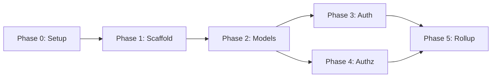
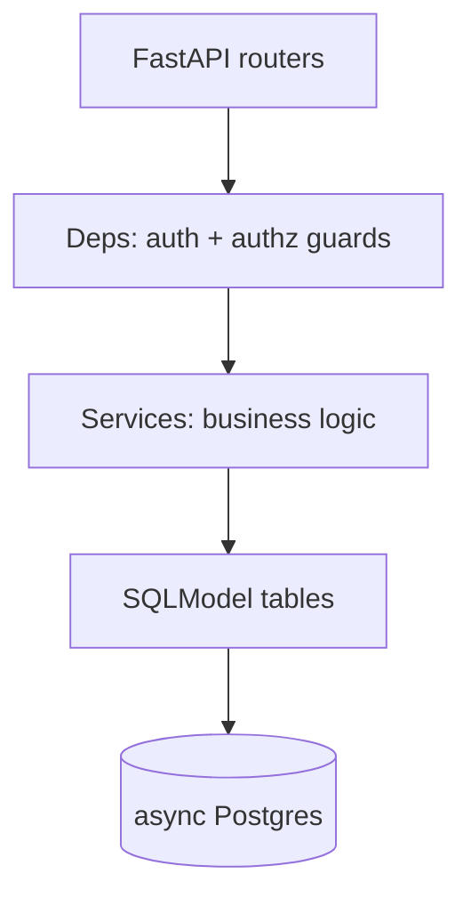
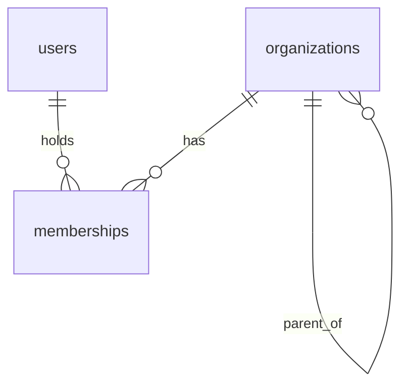
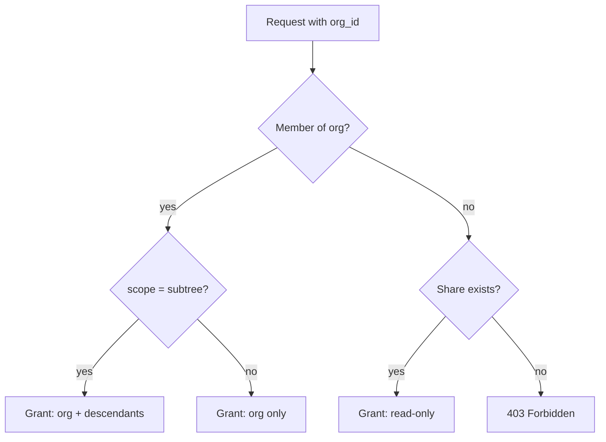
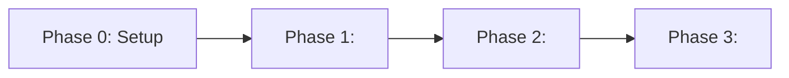

# Plan Skill

Guides creating structured implementation plans with a top-down approach, living status tracking, and a discipline of keeping all plan files in sync with the current truth.

## Quality Bar — Executor-Proof

Every plan must be written for an executor with **zero conversation context, possibly a lower-tier model**, who does exactly what is written and nothing more. Exact paths and names (never "something like"), exhaustive file lists including easy-to-miss companions (barrel exports, generated files + regen commands, tests, README updates), explicit out-of-scope and applicable-invariant checklists, enumerated edge cases, and verification items that are runnable commands with expected outcomes. Before saving any phase file, run the litmus test: if the executor did only what is written, would the result be complete?

## Step 1 — Investigate the Codebase First

A plan written from assumptions is worse than no plan: the executor will faithfully build a duplicate of something that already exists, or fight conventions the codebase settled long ago. So before answering any planning question or writing any file, investigate. The request alone is never enough input.

Work through these in order:

1. **Map the territory.** Read `CLAUDE.md` (the agent index) and whatever per-area docs it routes to for the layers the request touches. Know where this kind of code lives before deciding what to create.
2. **Check prior plans.** List `docs/plans/` **and `docs/plans/_archive/`** (completed plans move there) and read the `README.md` of any plan whose name or scope overlaps the request. The work may already be planned, partially implemented, completed, or deliberately archived. If an existing plan covers part of the scope, extend or reference it — never start a parallel plan over the same ground.
3. **Hunt for existing implementations.** Search the code for the features, models, endpoints, screens, and utilities the request implies — including synonyms, since a "notifications" feature may live under "alerts". Classify each piece as: **already exists** (reuse/extend it), **partially exists** (integrate with it), or **absent** (the plan creates it).
4. **Read what the plan will touch.** Open the actual files the phases will modify. Note the conventions in force — naming, layering, DI patterns, test style, migration workflow — so phases prescribe code that fits this codebase, not generic boilerplate.
5. **Write down findings as you go**, with `file:line` references. These become the **Existing State** section of `phase-0-setup.md` (see [Phase 0 — Setup](#phase-0--setup)), so the executor inherits the evidence, not just the conclusions.

When the scope is broad or the area unfamiliar, fan out parallel read-only Explore subagents (one per layer or subsystem) instead of reading everything serially — you need the conclusions, not the file dumps.

**Litmus test before moving on:** can you name, with paths, (a) what already exists that this plan reuses or extends, and (b) at least one convention the new code must follow? If not, keep investigating.

## Step 2 — Frame the Plan

With the investigation done, answer these before writing any file. If the user's input is vague on **goal or constraints** (things research can't answer), ask up to 2 clarifying questions before proceeding — never more than 2 at once. Don't ask about anything the codebase can answer; that's what Step 1 was for.

- **Goal**: Feature, refactor, migration, investigation, or integration?
- **Scope**: Which layers are touched — db, backend, frontend, packages?
- **Constraints**: Deadline, backwards compatibility, feature flags, dependencies on other work?
- **Existing art**: From Step 1 — what exists that this plan reuses, extends, or must not duplicate?
- **Natural phases**: How many phases does this break into? (1 = simple, 2–5 = moderate, 6+ = consider splitting into sub-plans)
- **Done criteria**: What does "complete" look like for each phase?
- **Phase dependencies**: Can any phases run in parallel, or is there a strict order?

## Top-Down Approach

Always define structure BEFORE writing content (and never before Step 1's investigation is done):

1. Name the plan (kebab-case folder name)
2. List all phase names + one-line summaries — no detail yet
3. Identify dependencies between phases — capture them as a Mermaid phase-dependency DAG (see [Diagrams with Mermaid](#diagrams-with-mermaid)). Drawing the graph surfaces which phases can run in parallel and which form a strict chain, before you commit to detail.
4. Only then fill in detail phase by phase

Never write phase content before the structure is settled.

## Diagrams with Mermaid

Plans live in markdown and render on GitHub and most editors, so prefer **Mermaid** over ASCII art or external images for anything structural. Mermaid is plain text: it diffs cleanly, stays in sync under version control, and forces dependencies and branches to be explicit instead of buried in prose. A reader should grasp the shape of the work from the diagrams before reading a word.

Pick the diagram that fits the intent:

| To show… | Use | Lives in |
|---|---|---|
| Phase order & what runs in parallel | `flowchart LR` (DAG) | README.md |
| Architecture / layers / data flow | `flowchart TD` | phase-0-setup.md |
| Entities & relationships (schema) | `erDiagram` | phase-0-setup.md |
| Request / multi-service interaction | `sequenceDiagram` | the relevant phase |
| Branching business logic | `flowchart TD` with decision nodes | the relevant phase |
| Status / lifecycle of an entity | `stateDiagram-v2` | the relevant phase |

Keep each diagram to one idea; if a flowchart needs more than ~15 nodes, split it. Diagrams **complement** the exact file lists and verification checklists — they never replace them. A picture of the architecture is not an executor-proof list of files to create, so the prose and tables still carry the precise truth. Keep directory trees as plain-text code blocks; Mermaid is poor at those.

**Phase dependency DAG** — every multi-phase plan's README carries one so order and parallelism are obvious at a glance:



Here Phases 3 and 4 both depend on 2 but not on each other, so they can run in parallel — the graph makes that visible without a sentence explaining it.

**Architecture / data flow** (phase-0):



**Data model** (phase-0):



**Branching logic** (in the phase that implements it) — use decision nodes to make every path and edge case explicit, which doubles as a checklist for the Verification section:



## File Structure

```
docs/plans/<plan-name>/
├── README.md              # Index + status tracker (living document)
├── explainer.html         # Published explainer artifact — plain explanation, UI walkthrough, developer briefing
├── phase-0-setup.md       # Planning phase: structure, decisions, constraints
├── phase-1-<name>.md
├── phase-2-<name>.md
└── ...
```

For single-phase plans: still create the folder + README + phase-0-setup.md + phase-1.md + explainer.html.

## README.md — The Living Index

The README is the single source of truth for plan status. It contains:

- **Overview**: what this plan is for (2–3 sentences)
- **Status table**: one row per phase with name, status badge, and one-line description
- **Phase dependency graph**: a Mermaid DAG of phase order and parallelism (see [Diagrams with Mermaid](#diagrams-with-mermaid))
- **Key decisions**: bullet list of non-obvious choices made during planning
- **How to resume**: what to read first when picking this up again

**Status badges:** `⬜ Not Started` | `🔄 In Progress` | `✅ Done` | `⚠️ Revised` | `🔁 Rework`

- `⬜ Not Started` — not yet begun
- `🔄 In Progress` — actively being implemented
- `✅ Done` — completed and verified
- `⚠️ Revised` — approach changed before or during implementation (plan updated in place)
- `🔁 Rework` — was ✅ Done, but must be revisited due to new requirements, bugs, or upstream changes

Update the README whenever any phase starts, completes, or changes.

### README Template

```markdown
# <Plan Name>

<2–3 sentence overview of what this plan is for and why.>

## Status

| Phase | Status | Description |
|-------|--------|-------------|
| Phase 0: Setup     | ✅ Done       | Define structure, decisions, constraints |
| Phase 1: <Name>    | ✅ Done       | <One-line description> |
| Phase 2: <Name>    | 🔁 Rework     | <One-line description> — _rework: <one-line reason>_ |
| Phase 3: <Name>    | ⬜ Not Started | <One-line description> |

## Phase Dependencies



## Key Decisions

- <Decision 1 and brief rationale>
- <Decision 2 and brief rationale>

## How to Resume

1. Read this README for current status
2. Read `phase-0-setup.md` for overall architecture
3. Open the current 🔄 In Progress or 🔁 Rework phase file
```

## Phase 0 — Setup

The first phase is always `phase-0-setup.md`. It does NOT implement anything. It defines the plan contract:

- **Existing State** — the findings from Step 1, with `file:line` references: what already exists and is reused/extended, what partially exists and must be integrated with, which conventions the new code follows, and which prior plans in `docs/plans/` overlap (and how this plan relates to them). This section is the evidence that the plan isn't rebuilding what's already there.
- Overall architecture and approach — as a Mermaid `flowchart TD` (see [Diagrams with Mermaid](#diagrams-with-mermaid))
- All files to be created or modified across all phases (organized by phase)
- Constraints and key decisions
- Schemas or data models, if relevant — as a Mermaid `erDiagram`

All other phases are written based on phase-0. If phase-0 changes, all other phases must be reviewed for consistency.

## Phase File Structure

Status badge in the header must be kept in sync with README.md. All five states are valid: `⬜ Not Started` | `🔄 In Progress` | `✅ Done` | `⚠️ Revised` | `🔁 Rework`.

For 🔁 Rework phases, add a `**Rework:**` line directly under Goal:

```markdown
# Phase N: <Name> — 🔁 Rework

**Goal**: One sentence — what this phase delivers.
**Rework:** One sentence — what changed and why this phase must be redone.
```

Standard structure:

```markdown
# Phase N: <Name> — <Status Badge>

**Goal**: One sentence — what this phase delivers.

## Scope

- What is in scope
- What is explicitly out of scope

## Implementation

[Technical detail: files to create/modify, code patterns, SQL, API contracts, etc.]

For non-trivial control flow, multi-service request paths, or status lifecycles, add a Mermaid diagram (`flowchart TD` with decision nodes, `sequenceDiagram`, or `stateDiagram-v2` — see [Diagrams with Mermaid](#diagrams-with-mermaid)). Enumerating every branch in the diagram makes the edge cases explicit and feeds directly into the Verification checklist below.

## Verification

- [ ] Acceptance criterion 1
- [ ] Acceptance criterion 2

## Notes

Gotchas, decisions made during this phase, or deviations from phase-0-setup.
```

## Explainer Artifact

After the plan files are written, create one artifact that explains the plan. The artifact is a rendered web page. The markdown files stay the executor contract; the artifact is the human briefing.

**The page has up to three parts, in this order:**

1. **Part 1 — the plain explanation.** For a reader who knows nothing about this area. Big pictures, few words.
2. **Part 2 — the UI walkthrough.** A clickable mockup of the finished feature, drawn in the real app's theme, that steps the user through using it. Include it whenever the plan changes anything a user sees; leave it out for backend-only plans (the page then has two parts, and the developer briefing becomes Part 2).
3. **Part 3 — the developer briefing.** For a developer who has not read the plan files.

One file, one URL, three reading levels. Part 1 must come first. A reader who stops at the end of Part 1 must still understand what the plan builds and why; a reader who stops at the end of Part 2 must know exactly what they will click and see.

**Rules:**

- The artifact is **one self-contained HTML file**. Put all CSS and JavaScript inline in the file. Do not load external scripts, stylesheets, or images. Google Fonts is the only permitted external resource.
- Write the file as `explainer.html` **inside the plan folder** (`docs/plans/<plan-name>/explainer.html`). The repo tracks the file with the plan. Do not write it to a scratch directory and do not move it later — a moved file gets a new artifact URL on republish.
- Load the `artifact-design` skill before you write the file.
- Publish the file with the Artifact tool. Give the user the URL.
- Set a short `<title>`, named for the plan.
- Design the parts as one page. Use one palette and one type scale throughout — except inside the Part 2 mockup frame, which uses the app's own tokens. Mark the seam between parts with a clear divider and a heading.
- Inline JavaScript is allowed where the page needs it (the Part 2 stepper). The page must still read top to bottom with JavaScript off.

### Part 1 — the plain explanation

The rule is the `eli5` skill's rule: explain it to a reader who knows nothing about the topic, with big pictures and few words.

**Write it like this:**

- Lead with the picture. Each panel is one diagram and one short caption. The diagram carries the idea; the caption names it.
- Use maximum 40 words of prose in a panel. Cut a sentence before you add one.
- Use the reader's words, not the code's. Write "the app hides the button", not "the client gates the transition". Name a class or a file only when the reader needs to find it.
- Show one idea in each panel. Six to ten panels is the normal length.
- Use real names and real numbers from the plan. Never use a placeholder.
- Number the panels only when the content is a true sequence.

**These panels earn their place in most plans.** Pick the ones that fit:

| Panel | Answers |
|---|---|
| What exists today | What does a person do now, before this plan? |
| What breaks | Why is today's way not good enough? |
| The idea in one picture | What does the plan change? |
| The moving parts | Which pieces are there, and what does each one do? |
| The path of one request | What happens, step by step, when somebody uses it? |
| What changes for the user | What is different on the screen after this ships? |
| The order of work | Which phase comes first, and what can run in parallel? |
| What could go wrong | Which risks are real, and what is the answer to each? |

**Do not do these things in Part 1:**

- Do not use a metaphor. Say what the code does (root `CLAUDE.md`).
- Do not use an acronym before you say what it means.
- Do not paste a code block, a file path, or an API path.
- Do not write a paragraph that explains why the design is clever.

### Part 2 — the UI walkthrough

Read [references/ui-walkthrough.md](references/ui-walkthrough.md) before building this part. It says where the app's theme lives, how to pick the steps, and how to build the stepper.

The short version:

- **Look like this app.** Copy the color tokens from `frontend/src/styles/globals.css` (both light and dark) and scope them to the mockup; mirror the sidebar, cards, buttons, and dialogs from the real components and `style-nova.css`. Use the real labels from the screens the plan touches. Guessing the theme produces a generic dashboard the user does not recognize, which defeats the point.
- **One action per step, four to eight steps**, from where the user starts to the screen that shows the result. Each step highlights the one element to click or read, with a one-line instruction.
- **Numbers from the plan's worked example**, consistent across steps — the mockup is also a check that the plan's arithmetic holds on screen.
- **Tag each step with the phase that ships it**, and flip the tag to "Live" when that phase is ✅ Done.
- **Frame it as a mockup** (browser frame, "Mockup — not the live app" label) so nobody mistakes it for real data.

Part 1's "What changes for the user" panel stays a simple before/after picture; the walkthrough is where the detail goes.

### Part 3 — the developer briefing

This part explains the goal, the key decisions with their rationale, the phase order, and the risks. Write it for a developer who has not read the plan files. Give exact names here — modules, endpoints, tables, files. Link nothing; the page must stand alone.

**Diagrams:** draw the diagrams with HTML and CSS (flex/grid boxes, borders, inline SVG) in Parts 1 and 3. Part 1 needs simple pictures — boxes, arrows, and one idea in each. Part 3 needs the precise ones. Decide which diagram types serve this plan best — pick 2–4 for Part 3, never all. Use this priority list as the guide:

| Priority | Diagram | Usefulness | Best for |
|---|---|---|---|
| 🥇 1 | Architecture / Component | ⭐⭐⭐⭐⭐ | The whole system: services, APIs, databases, queues, external systems |
| 🥈 2 | Sequence | ⭐⭐⭐⭐⭐ | How a request flows through the system |
| 🥉 3 | ER | ⭐⭐⭐⭐⭐ | Database design and relationships |
| 4 | Class | ⭐⭐⭐⭐ | Domain models, classes, interfaces |
| 5 | Flowchart | ⭐⭐⭐⭐ | Algorithms and business logic |
| 6 | State | ⭐⭐⭐⭐ | Lifecycle / state machines |
| 7 | Deployment | ⭐⭐⭐ | Infrastructure and where components run |
| 8 | Activity | ⭐⭐⭐ | Business / process workflows |
| 9 | Use case | ⭐⭐ | Requirements and user interactions |
| 10 | Object | ⭐⭐ | Concrete examples of class instances |
| 11 | Communication | ⭐⭐ | Message relationships between objects |
| 12 | Package | ⭐⭐ | Organizing large codebases |
| 13 | Timing | ⭐⭐ | Time-sensitive / real-time systems |
| 14 | Composite structure | ⭐ | Detailed internal component structure |
| 15 | Interaction overview | ⭐ | Complex interaction workflows |
| 16 | Profile | ⭐ | Specialized / custom UML |

**Keep it current:** when a key decision changes, or the phase structure changes, update **every part** of `explainer.html` that it affects and publish it again with the same file path. The same-path republish keeps the same URL. A decision that changes Part 3 usually changes the picture in Part 1 and often a walkthrough step — check both. When a phase that changes UI lands, reconcile the walkthrough with the shipped screens (labels, field order, layout), flip its steps to "Live", and republish. Commit the updated file in the same PR as the plan change.

## When a Phase Must Change

### Approach changed mid-flight → ⚠️ Revised

The phase isn't done yet but the plan is wrong. Update in place:

1. **Edit the phase file** — remove the wrong path, keep only current truth
2. **Update phase-0-setup.md** — if overall structure or decisions changed
3. **Mark the phase ⚠️ Revised** in README.md
4. **Check downstream phase files** — if they depended on the wrong approach, update them too

### Completed phase must be redone → 🔁 Rework

A ✅ Done phase is invalidated by new requirements, upstream changes, or a bug discovered post-ship:

1. **Mark 🔁 Rework** in README.md, append `— _rework: <one-line reason>_` to the description
2. **Add `**Rework:**` line** to the phase file header (one sentence — what changed and why)
3. **Update Implementation and Verification sections** to reflect new scope
4. **Reset Verification checklist items** that must be re-verified
5. When complete, mark ✅ Done again — no new phase file needed

**Rule:** Plan files show only the current truth. No "what we tried" or "previously we..." history. Past mistakes live in git history — not in the docs.
