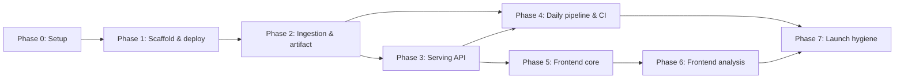

# DTS Webapp — Public Launch on Vercel + Cloudflare

Rebuilds `../dts-analysis/fullstack_app` as a public web app: a daily ingestion job builds an
immutable DuckDB file, Cloudflare R2 stores it, and Vercel serves a read-only FastAPI API and
the Vite frontend from one project. The repo skeleton, design tokens, sidebar shell, and
conventions are copied from `../family-financial-app`; the financial logic is ported from
dts-analysis, folding in the fixes from `dts-analysis/docs/plans/fullstack-code-improvements/`.

Accounts, subscriptions, and payments are **out of scope** — they get their own plan once the
free public app is live (see Key Decisions).

## Status

| Phase | Status | Description |
|-------|--------|-------------|
| Phase 0: Setup | ✅ Done | Architecture, file inventory, decisions, constraints |
| Phase 1: Scaffold & first deploy | ✅ Done | Monorepo skeleton, tokens + sidebar shell, `/api/health` live on Vercel Services |
| Phase 2: Ingestion & data artifact | ✅ Done | `python -m app.ingest` builds `treasury_data.duckdb`; R2 bucket; Vercel build bundles it; cold start measured |
| Phase 3: Serving API | ✅ Done | Read-only DuckDB, all reference endpoints ported as cacheable `GET`s, SQL pagination, tests, OpenAPI contract |
| Phase 4: Daily pipeline & CI | ⬜ Not Started | GitHub Actions cron: ingest → R2 → Vercel Deploy Hook; CI workflow for lint/tests/typecheck |
| Phase 5: Frontend — core pages | ✅ Done | Overview, Data status, Single date, Daily net transfers, Fiscal year |
| Phase 6: Frontend — analysis pages | 🔄 In Progress | Year-over-year suite, category comparison, weekly comparison (week-alignment fix), Vitest |
| Phase 7: Launch hygiene | ⬜ Not Started | Cache verification, rate limiting, error monitoring, methodology + legal pages |

## Phase Dependencies

Phase 4 and Phases 5→6 are independent tracks once Phase 3 lands and can run in parallel.

## Key Decisions

- **Ingestion and serving are separate programs.** Ingestion (`app/ingest/`) is the only code
  that writes; the API opens the artifact `read_only=True` with a cursor per request. This
  removes the reference app's whole concurrency problem class (fetch races, partial refresh,
  task bookkeeping) instead of fixing it: improvement-plan phases 1–2 become unnecessary,
  phases 3–4 are folded into Phases 2–3 here, phases 5–7 into Phases 3, 5, 6.
- **Every data endpoint becomes `GET`.** The reference API uses `POST` with JSON bodies for
  fiscal-year, date-range, weekly, YoY and category queries. CDNs never cache `POST`, so those
  bodies become query parameters. The redundant `POST /data/fiscal-year` and
  `POST /data/date-range` are dropped — `GET /data` already filters by both.
- **Deploy = data refresh.** The `api` service build downloads `latest/treasury_data.duckdb`
  from R2 and bundles it into the function. Vercel's CDN cache key includes the deployment URL,
  so each daily deploy starts a clean cache; responses use `s-maxage=86400` plus
  `stale-while-revalidate`. Rollback to yesterday's data = promote yesterday's deployment.
- **One Vercel project with Vercel Services** (`web` = `frontend/`, `api` = `backend/`), one
  origin, no CORS. Services is in beta; the fallback is two projects with an external rewrite
  (Phase 1 Notes).
- **Cloudflare is storage, not a proxy.** R2 holds the artifact (dated snapshots + `latest/`).
  No Cloudflare proxy in front of Vercel — Vercel's CDN already caches the API, and there is no
  custom domain yet. All Cloudflare operations use the `cf` CLI (`cf@1.0.0-beta.18`).
- **The R2 bucket is publicly readable via its r2.dev URL** so the Vercel Python build can
  download with stdlib `urllib` and no credentials. The data is public-domain Treasury data.
  Revisit (private bucket + signed download) in the subscriptions plan.
- **Ingestion fails whole, never partial.** Unlike the reference's per-endpoint
  catch-and-continue, any endpoint failure aborts the run; yesterday's artifact stays live and
  the workflow fails loudly. Retries (urllib3 `Retry`) absorb transient Treasury errors.
- **`day_of_fiscal_year` = DENSE_RANK of `record_date` within the FY**, as decided in the
  reference improvement plan — ingestion computes `daily_net_transfers` with it from day one.
- **Vercel Hobby until money moves.** Hobby forbids commercial use; the subscriptions plan
  starts by upgrading to Pro ($20/mo).
- **Python: uv only** (`uv sync`, `uv add`, `uv run`); `requests` lives in an `ingest`
  dependency group so the serving bundle does not carry it.

## How to Resume

1. Read this README for current status
2. Read `phase-0-setup.md` for the architecture, file inventory, and invariants
3. Open the current 🔄 In Progress or 🔁 Rework phase file
4. The explainer page (`explainer.html`) is the human briefing; the phase files are the
   executor contract
