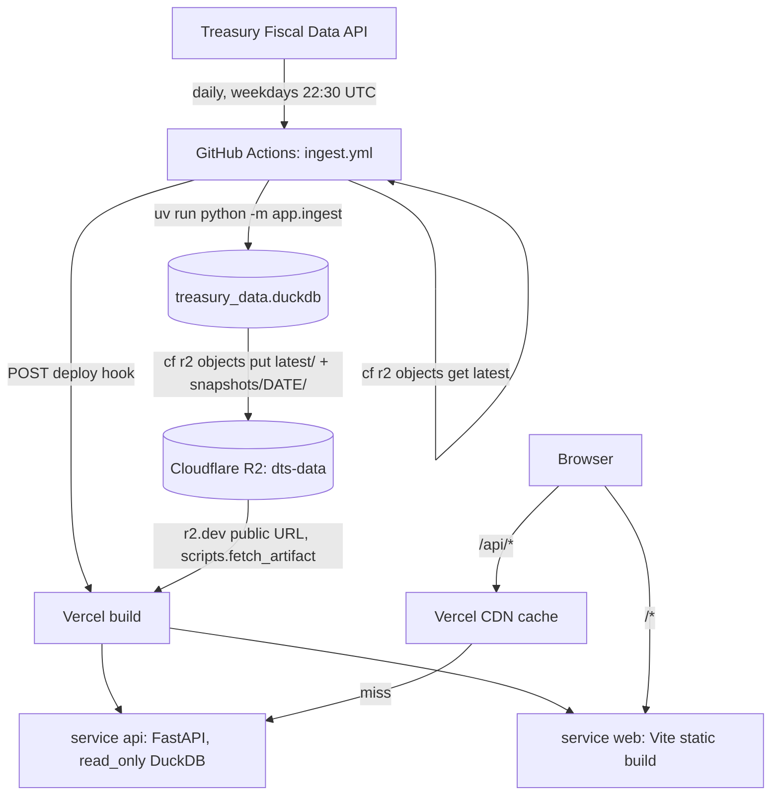
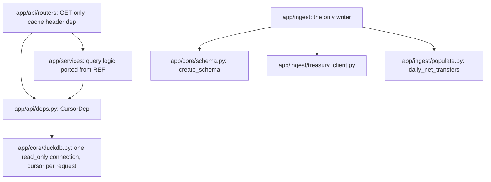
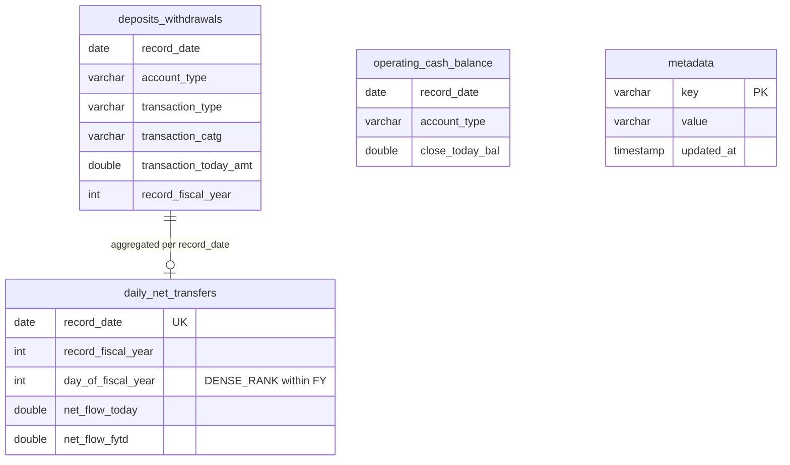

# Phase 0: Setup — ✅ Done

**Goal**: Define the contract every later phase implements: what already exists and is reused,
the target architecture, the complete file inventory, the endpoint map, and the invariants.

Path conventions in this plan:
- Paths with no prefix are relative to this repo (`dts-webapp/`).
- `REF/` = `/home/hminle/gitrepos/personal-projects/dts-analysis/fullstack_app/` (the
  financial-logic reference).
- `FAM/` = `/home/hminle/gitrepos/personal-projects/family-financial-app/` (the
  structure/design reference).

## Existing State

### This repo
- Only `README.md`, `LICENSE`, `CLAUDE.md`, and `.claude/skills/` (copied from
  `FAM/.claude/skills/`: `fastapi`, `minimalist-ui`, `planner`, `python-style`, `shadcn`,
  `skill-creator`). No code. No prior plans in `docs/plans/`. Remote:
  `git@github.com:hminle/dts-webapp.git`.

### Financial logic to port (REF)
- **Schema** — `REF/backend/app/duckdb_database.py:111-426` (`_init_schema`): `metadata`, 9
  endpoint tables, derived `daily_net_transfers`, sequences, and `record_date` /
  `record_fiscal_year` indexes. Table inventory tuples at `:28-51` (`ENDPOINT_TABLES`,
  `DERIVED_TABLES`, `ALL_TABLES`, `ACCOUNT_TYPE_TABLES`). `insert_dataframe` at `:615-688`
  (column alignment logic is reused; the COUNT-delta is replaced by `len(df)`).
- **Treasury client** — `REF/backend/app/services/treasury_api.py`: endpoint paths `:23-33`,
  pagination `fetch_all_pages` `:92`, `process_data` `:153` (type coercion of API strings),
  `fetch_date_range` `:233`, `fetch_new_data` `:281`. Full history starts at `2005-01-01`
  (`REF/backend/app/api/fetch.py:385-397`).
- **Daily net transfers** — `REF/backend/app/utils/deposits_withdrawals.py:16`
  (`calculate_daily_net_transfers`, the net-flow formula) and
  `REF/backend/app/api/treasury/net_transfers.py:180-251` (`_compute_daily_records`, whose
  skip-aware counter at `:217-219` is replaced by DENSE_RANK numbering).
- **Query endpoints** — `REF/backend/app/api/treasury/`: `data.py` (pandas pagination — the
  one real performance bug), `lookups.py`, `weekly.py`, `net_transfers.py`, `yoy.py`,
  `major_categories.py`; helpers `REF/backend/app/utils/yoy.py`,
  `REF/backend/app/utils/pydantic_helpers.py`, `REF/backend/app/constants/categories.py`;
  stats in `REF/backend/app/api/database.py:22-213`. Wire models in
  `REF/backend/app/schemas/treasury.py` (584 lines).
- **Frontend pages** — `REF/frontend/src/pages/` (Home, single-date ×2, fiscal-year,
  weekly-comparison, yoy-analysis ×3, yoy-comparison), shared `REF/frontend/src/components/`
  (`charts/*`, `yoy/*`, `CategoryDetailModal.tsx`), formatters `REF/frontend/src/lib/utils.ts`,
  palette `REF/frontend/src/lib/chart.ts`, nav labels `REF/frontend/src/components/Layout.tsx:17-32`.
  Page → endpoint usage:

  | REF page/component | Calls |
  |---|---|
  | `pages/Home.tsx` | `database.getStats` |
  | `pages/single-date/DepositsWithdrawals.tsx` | `getDataByDate`, `getDailyNetTransfers` |
  | `pages/single-date/CompareDailyNetTransfers.tsx` | `getFiscalYears`, `getDailyNetTransfersByFiscalYear` |
  | `pages/fiscal-year/FiscalYear.tsx` | `getFiscalYears`, `getDataSources`, `getDataByFiscalYear` |
  | `pages/weekly-comparison/WeeklyComparison.tsx` | `getFiscalYears`, `getWeeklyComparison` |
  | `components/yoy/YoYAnalysisLayout.tsx` | `getFiscalYears`, `getYoYDailyComparison` |
  | `components/yoy/SpendingCategoriesSection.tsx` | `getMajorSpendingCategories`, `getTBillInterest`, `getIrsTaxRefunds` |
  | `components/yoy/ReceiptCategoriesSection.tsx` | `getMajorReceiptCategories` |
  | `components/CategoryDetailModal.tsx` | `getCategoryDailyYoY` |
  | `pages/yoy-comparison/YoYCategoryComparison.tsx` | `getYoYCategoryComparison` |
  | `pages/database/*` | fetch/populate admin — **not ported** |

- **Known bugs to fix while porting** (from `dts-analysis/docs/fullstack/code-analysis-2026-07.md`
  via the improvement plan): weekly mappers pair weeks by array index
  (`REF/frontend/src/pages/weekly-comparison/WeeklyComparison.tsx:76-104`); `yoy.py:113-116`
  and `data.py:96-115` swallow query errors and return empty data; `treasury_api.py:59-64`
  falls back to a default endpoint on unknown keys; `get_table_name_for_endpoint`
  (`duckdb_database.py:528-531`) falls back to `deposits_withdrawals`; settings in
  `REF/backend/app/config.py` are ignored by the client (module constants win). All REF query
  handlers are `async def` doing blocking DuckDB calls — they block the event loop.

### Structure and design to copy (FAM)
- **Repo layout** — `backend/` (uv, FastAPI, `app/api/routers`, `app/services`,
  `app/schemas`, `app/core`), `frontend/` (pnpm, Vite), `docs/contracts/openapi.json`,
  `docs/plans/`, `scripts/dev.sh` (`FAM/scripts/dev.sh`, polls `/api/health`).
- **Backend conventions** — `FAM/backend/app/main.py:44-47` `generate_unique_id` →
  `"{tag}_{route.name}"`; `FAM/backend/app/api/deps.py` `Annotated[..., Depends(...)]` aliases;
  `FAM/backend/app/core/config.py` pydantic-settings with `env_prefix="APP_"`;
  `FAM/backend/scripts/export_openapi.py` writes `docs/contracts/openapi.json`;
  `FAM/backend/pyproject.toml` ruff `line-length = 88`, `select = ["E","F","I","UP","B"]`,
  `[tool.fastapi] entrypoint`.
- **Frontend shell** — `FAM/frontend/src/routes/__root.tsx` (TooltipProvider → SidebarProvider →
  sidebar + `SidebarInset className='min-w-0'` + Toaster, `errorComponent`, `notFoundComponent`);
  `FAM/frontend/src/components/layout/app-sidebar.tsx` (`collapsible='icon' variant='inset'`,
  header / `NavGroup` / footer menu / `SidebarRail`); `nav-group.tsx` (links, collapsibles,
  collapsed-mode dropdowns, `checkIsActive`); `types.ts` (`NavLink` / `NavCollapsible`);
  `header.tsx`, `main.tsx`; `app-title.tsx` (unused template brand block — becomes our header).
- **Design tokens** — `FAM/frontend/src/styles/globals.css` (oklch tokens in `:root` / `.dark`,
  `--radius: 0.625rem`, `--chart-1..5`, sidebar tokens, extended success/info/warning) and
  `FAM/frontend/src/styles/style-nova.css` (1550 lines of `cn-*` component looks);
  `FAM/frontend/components.json` (`style: base-nova`, `baseColor: neutral`, lucide, `@reui`
  registry); `FAM/frontend/index.html` puts `class="style-nova"` on `<html>`.
  **Gap:** `--font-inter` is referenced (`globals.css:25,95-96`) but never defined or loaded,
  so FAM actually renders in the browser's default sans-serif. This plan loads Inter.
- **Copied component layers have no app dependencies**: every `@/` import inside
  `FAM/frontend/src/components/ui/`, `components/reui/`, `hooks/`, `lib/table.ts` resolves to
  those same directories, `lib/utils.ts`, or `components/icon-placeholder.tsx` (verified with
  grep) — they can be copied wholesale.
- **Frontend conventions** — `FAM/frontend/vite.config.ts` (router plugin with
  `autoCodeSplitting: true`, `/api` dev proxy to `VITE_API_TARGET`, vitest jsdom + setup);
  `FAM/frontend/src/lib/api/client.ts` (`openapi-fetch`, `errorMessage(error, fallback)`);
  `FAM/frontend/src/test/setup.ts` (jsdom stubs); `package.json` scripts `dev`, `build`,
  `typecheck`, `test`, `gen:api`.

### Platform facts (verified against vendor docs, Oct 2026)
- **Vercel Services** (beta, all plans): `vercel.json` `services` map + top-level `rewrites`
  with `destination: { "service": "<name>" }`; the service receives the **original path**
  (`/api/v1/x` stays `/api/v1/x`). Build/runtime keys (`functions`, `buildCommand`, …) go inside
  the service. Local: `vercel dev -L`.
- **Vercel Python**: detects FastAPI `app`; `pyproject.toml` + `uv.lock` installed with uv;
  Python 3.12 default; `[tool.vercel.scripts] build = "..."` runs after dependency install;
  bundle limit 500 MB uncompressed; all reachable project files are bundled; filesystem is
  read-only except `/tmp`.
- **Vercel CDN**: caches function responses with `s-maxage` / `stale-while-revalidate`; only
  `GET`/`HEAD`; never caches requests with an `Authorization` header or responses with
  `Set-Cookie`; cache key includes the deployment URL (new deployment = new cache).
- **cf CLI** (`cf@1.0.0-beta.18`): `cf r2 buckets create --name`, `cf r2 buckets domains
  managed update <bucket> --enabled --force`, `cf r2 buckets domains managed list <bucket>`,
  `cf r2 objects put <key> --bucket-name <b> --file <path>` (≤300 MB), `cf r2 objects get <key>
  --bucket-name <b>` (raw bytes to stdout). CI auth: `CLOUDFLARE_API_TOKEN` +
  `CLOUDFLARE_ACCOUNT_ID`.

## Architecture





## Data model

Unchanged from REF (`REF/backend/app/duckdb_database.py:111-426`), plus `metadata` keys written
by ingestion. All 9 endpoint tables share `record_date`, `record_fiscal_year`, the
`record_calendar_*` columns, `table_nbr`, `table_nm`, `src_line_nbr`, `created_at`,
`updated_at`.



`metadata` keys after Phase 2: `build_date` (UTC ISO timestamp of the ingest run),
`latest_record_date` (max `record_date` of `deposits_withdrawals`), `source`
(`https://fiscaldata.treasury.gov/datasets/daily-treasury-statement/`), `schema_version`
(`"1"`). REF's `fetch_task_*` / `daily_net_transfers_task_*` keys do not exist here.

## Endpoint Map (REF → this repo)

Prefix for data routes: `/api/v1`. Every route is `GET` and sync (`def`, not `async def`).
Tags become the first half of the operation id.

| REF | This repo | Tag / router file |
|---|---|---|
| `GET /health` | `GET /api/health` | `health` / `routers/health.py` |
| `GET /api/v1/database/stats` | `GET /api/v1/meta/stats` | `meta` / `routers/meta.py` |
| `GET /api/v1/database/record-counts` | `GET /api/v1/meta/record-counts` | `meta` |
| `GET /api/v1/database/record-counts-by-year` | `GET /api/v1/meta/record-counts-by-year` | `meta` |
| — (new) | `GET /api/v1/meta/build` | `meta` |
| `GET /api/v1/treasury/data` | `GET /api/v1/data` | `data` / `routers/data.py` |
| `GET /api/v1/treasury/data/date/{date}` | `GET /api/v1/data/date/{date}` | `data` |
| `POST /api/v1/treasury/data/fiscal-year` | dropped → `GET /api/v1/data?fiscal_year=` | — |
| `POST /api/v1/treasury/data/date-range` | dropped → `GET /api/v1/data?start_date=&end_date=` | — |
| `GET /api/v1/treasury/account-types` | `GET /api/v1/lookups/account-types` | `lookups` / `routers/lookups.py` |
| `GET /api/v1/treasury/data-sources` | `GET /api/v1/lookups/data-sources` | `lookups` |
| `GET /api/v1/treasury/fiscal-years` | `GET /api/v1/lookups/fiscal-years` | `lookups` |
| `GET /api/v1/treasury/data/deposits-withdrawals/categories` | `GET /api/v1/lookups/categories` | `lookups` |
| `GET /api/v1/treasury/data/date/{date}/daily-net-transfers` | `GET /api/v1/net-transfers/date/{date}` | `net_transfers` / `routers/net_transfers.py` |
| `GET /api/v1/treasury/data/daily-net-transfers/fiscal-year/{fy}` | `GET /api/v1/net-transfers/fiscal-year/{fiscal_year}` | `net_transfers` |
| `POST /api/v1/treasury/data/weekly-comparison` | `GET /api/v1/weekly/comparison` | `weekly` / `routers/weekly.py` |
| `POST /api/v1/treasury/data/yoy-category-comparison` | `GET /api/v1/yoy/category-comparison` | `yoy` / `routers/yoy.py` |
| `POST /api/v1/treasury/data/yoy-daily-comparison` | `GET /api/v1/yoy/daily-comparison` | `yoy` |
| `POST /api/v1/treasury/data/major-spending-categories` | `GET /api/v1/categories/major-spending` | `categories` / `routers/categories.py` |
| `POST /api/v1/treasury/data/major-receipt-categories` | `GET /api/v1/categories/major-receipts` | `categories` |
| `POST /api/v1/treasury/data/tbill-interest` | `GET /api/v1/categories/tbill-interest` | `categories` |
| `POST /api/v1/treasury/data/irs-tax-refunds` | `GET /api/v1/categories/irs-tax-refunds` | `categories` |
| `POST /api/v1/treasury/data/category-daily-yoy` | `GET /api/v1/categories/daily-yoy` | `categories` |
| `GET /api/v1/database/metadata[/{key}]`, all `/api/v1/fetch/*`, `.../daily-net-transfers/populate`, `.../unpopulated-fiscal-years`, task-status routes | **not ported** (ingestion CLI replaces them) | — |

## File Inventory by Phase

### Phase 1 — Scaffold & first deploy
- Create: `.gitignore`, `vercel.json`, `scripts/dev.sh` (copy of `FAM/scripts/dev.sh`)
- Create backend: `backend/pyproject.toml`, `backend/uv.lock` (generated by `uv sync`),
  `backend/.python-version`, `backend/.gitignore`, `backend/README.md`,
  `backend/data/.gitkeep`, `backend/app/__init__.py`, `backend/app/main.py`,
  `backend/app/core/__init__.py`, `backend/app/core/config.py`,
  `backend/app/api/__init__.py`, `backend/app/api/routers/__init__.py`,
  `backend/app/api/routers/health.py`, `backend/app/schemas/__init__.py`,
  `backend/app/schemas/health.py`, `backend/scripts/__init__.py`,
  `backend/scripts/export_openapi.py`, `backend/scripts/fetch_artifact.py`,
  `backend/tests/__init__.py`, `backend/tests/conftest.py`, `backend/tests/test_health.py`
- Create frontend (copied from FAM, see Phase 1 for per-file edits): `frontend/package.json`,
  `frontend/pnpm-lock.yaml` (generated), `frontend/components.json`, `frontend/index.html`,
  `frontend/tsconfig.json`, `frontend/tsconfig.app.json`, `frontend/tsconfig.node.json`,
  `frontend/vite.config.ts`, `frontend/.gitignore`, `frontend/public/favicon.svg`,
  `frontend/src/main.tsx`, `frontend/src/vite-env.d.ts`, `frontend/src/routeTree.gen.ts`
  (generated), `frontend/src/styles/globals.css`, `frontend/src/styles/style-nova.css`,
  `frontend/src/lib/utils.ts`, `frontend/src/lib/table.ts`, `frontend/src/lib/query-client.ts`,
  `frontend/src/lib/api/client.ts`, `frontend/src/lib/api/schema.d.ts` (generated),
  `frontend/src/hooks/*` (5 files), `frontend/src/components/ui/*` (51 files),
  `frontend/src/components/reui/**` (16 files), `frontend/src/components/icon-placeholder.tsx`,
  `frontend/src/components/layout/{app-sidebar.tsx,app-title.tsx,header.tsx,main.tsx,nav-group.tsx,types.ts,data/sidebar-data.ts}`,
  `frontend/src/components/page-placeholder.tsx`, `frontend/src/routes/__root.tsx`,
  `frontend/src/routes/index.tsx` + 10 placeholder route files (`data-status`, `methodology`, `fiscal-year`, `weekly`, `daily/{single-date,net-transfers}`, `yoy/{net-transfers,withdrawals,deposits,categories}`), `frontend/src/test/setup.ts`,
  `frontend/src/components/layout/app-sidebar.test.tsx`
- Create: `docs/contracts/README.md`, `docs/contracts/openapi.json` (generated)
- Modify: `README.md` (project intro + quickstart)

### Phase 2 — Ingestion & data artifact
- Create: `backend/app/core/schema.py`, `backend/app/constants/__init__.py`,
  `backend/app/constants/endpoints.py`, `backend/app/utils/__init__.py`,
  `backend/app/utils/fiscal.py`, `backend/app/utils/deposits_withdrawals.py` (port),
  `backend/app/ingest/__init__.py`, `backend/app/ingest/__main__.py`,
  `backend/app/ingest/treasury_client.py`, `backend/app/ingest/build.py`,
  `backend/app/ingest/insert.py`, `backend/app/ingest/populate.py`,
  `backend/app/ingest/validate.py`, `backend/tests/fixtures.py`,
  `backend/tests/test_fiscal.py`, `backend/tests/test_treasury_client.py`,
  `backend/tests/test_ingest_populate.py`, `backend/tests/test_ingest_build.py`
- Modify: `backend/pyproject.toml` (`ingest` dependency group), `backend/README.md`
- Cloud (no repo files): R2 bucket `dts-data`, r2.dev public access, first `latest/` upload,
  Vercel env var `APP_ARTIFACT_URL`

### Phase 3 — Serving API
- Create: `backend/app/core/duckdb.py`, `backend/app/api/deps.py`, `backend/app/api/caching.py`,
  `backend/app/constants/categories.py` (port), `backend/app/utils/frames.py` (port of
  `pydantic_helpers.py`), `backend/app/utils/yoy.py` (port), `backend/app/schemas/treasury.py`
  (port), `backend/app/schemas/meta.py`, `backend/app/services/__init__.py`,
  `backend/app/services/{meta,lookups,data,net_transfers,weekly,yoy,categories}.py`,
  `backend/app/api/routers/{meta,lookups,data,net_transfers,weekly,yoy,categories}.py`,
  `backend/tests/test_meta_api.py`, `backend/tests/test_lookups_api.py`,
  `backend/tests/test_data_api.py`, `backend/tests/test_net_transfers_api.py`,
  `backend/tests/test_analysis_api.py`, `backend/tests/test_caching.py`
- Modify: `backend/app/main.py` (routers, 503 handler), `backend/app/api/routers/health.py`
  (data status), `backend/app/schemas/health.py`, `backend/tests/conftest.py` (seeded DB +
  client fixtures), `docs/contracts/openapi.json` (regenerated),
  `frontend/src/lib/api/schema.d.ts` (regenerated)

### Phase 4 — Daily pipeline & CI
- Create: `.github/workflows/ingest.yml`, `.github/workflows/ci.yml`, `docs/operations.md`
- Cloud: GitHub Actions secrets `CLOUDFLARE_API_TOKEN`, `CLOUDFLARE_ACCOUNT_ID`,
  `VERCEL_DEPLOY_HOOK_URL`, `HEALTHCHECK_PING_URL`; Vercel Deploy Hook; healthchecks.io check

### Phase 5 — Frontend core pages
- Create: `frontend/src/lib/format.ts`, `frontend/src/lib/format.test.ts`,
  `frontend/src/lib/fiscal.ts`, `frontend/src/lib/fiscal.test.ts`, `frontend/src/lib/chart.ts`,
  `frontend/src/components/fiscal-year-select.tsx`, `frontend/src/components/query-state.tsx`,
  `frontend/src/features/meta/api.ts`, `frontend/src/features/lookups/api.ts`,
  `frontend/src/features/overview/overview-page.tsx`,
  `frontend/src/features/overview/overview-page.test.tsx`,
  `frontend/src/features/data-status/data-status-page.tsx`,
  `frontend/src/features/daily/api.ts`, `frontend/src/features/daily/lib.ts`,
  `frontend/src/features/daily/lib.test.ts`,
  `frontend/src/features/daily/single-date-page.tsx`,
  `frontend/src/features/daily/components/{date-controls,net-transfers-summary,transactions-table,fiscal-year-table}.tsx`,
  `frontend/src/features/daily/net-transfers-page.tsx`,
  `frontend/src/features/fiscal-year/api.ts`,
  `frontend/src/features/fiscal-year/fiscal-year-page.tsx`, `frontend/src/test/api.ts`
- Modify (placeholder → real page): `frontend/src/routes/index.tsx`,
  `frontend/src/routes/data-status.tsx`, `frontend/src/routes/daily/single-date.tsx`,
  `frontend/src/routes/daily/net-transfers.tsx`, `frontend/src/routes/fiscal-year.tsx`

### Phase 6 — Frontend analysis pages
- Create: `frontend/src/components/charts/{chart-controls,yoy-line-chart,yoy-difference-chart,yoy-difference-line-chart}.tsx`,
  `frontend/src/features/yoy/api.ts`, `frontend/src/features/yoy/lib.ts`,
  `frontend/src/features/yoy/lib.test.ts`,
  `frontend/src/features/yoy/yoy-analysis-layout.tsx`,
  `frontend/src/features/yoy/{net-transfers-page,withdrawals-page,deposits-page,category-comparison-page}.tsx`,
  `frontend/src/features/yoy/components/{category-card,spending-categories-section,receipt-categories-section,category-detail-dialog,category-picker,comparison-chart,comparison-table,methodology-card}.tsx`,
  `frontend/src/features/weekly/api.ts`, `frontend/src/features/weekly/lib.ts`,
  `frontend/src/features/weekly/lib.test.ts`, `frontend/src/features/weekly/weekly-page.tsx`,
  `frontend/src/features/weekly/components/{year-picker,weekly-charts,summary-stats}.tsx`
- Modify (placeholder → real page): `frontend/src/routes/yoy/{net-transfers,withdrawals,deposits,categories}.tsx`,
  `frontend/src/routes/weekly.tsx`

### Phase 7 — Launch hygiene
- Create: `frontend/src/features/methodology/methodology-page.tsx`,
  `frontend/src/routes/methodology.tsx` (replace placeholder), `frontend/src/routes/terms.tsx`,
  `frontend/src/routes/privacy.tsx`, `frontend/src/components/data-disclaimer.tsx`,
  `docs/launch-checklist.md`
- Modify: `frontend/src/components/layout/app-sidebar.tsx` (disclaimer + legal links),
  `frontend/src/routes/__root.tsx` (Vercel Web Analytics), `frontend/package.json`
  (`@vercel/analytics`), `frontend/index.html` (meta description), `backend/app/main.py` (Sentry init), `backend/pyproject.toml`
  (`sentry-sdk[fastapi]`), `vercel.json` (security headers), `docs/operations.md`

## Invariants (apply to every phase)

1. **Serving never writes.** Only `app/ingest/` opens DuckDB writable. `app/core/duckdb.py`
   connects `read_only=True`; no module outside it stores a connection; routers receive a
   per-request cursor through `CursorDep` and never call `duckdb.connect`.
2. **Every serving route is `GET` and a sync `def`.** FastAPI runs sync handlers in its
   threadpool; each has its own cursor. No `async def` handler may touch DuckDB.
3. **No silent fallbacks.** Unknown keys → `ValueError` → HTTP 400; missing data for a requested
   date/FY → HTTP 404 with a human `detail`; query failure → propagates (HTTP 500). No
   `except Exception: return []`.
4. **Ingestion is all-or-nothing.** It writes a temp file, validates, `CHECKPOINT`s, closes,
   and `os.replace`s. Any failure exits non-zero and leaves the previous file untouched.
5. **Fiscal year**: Oct 1 starts the next FY (`current_fiscal_year`); `day_of_fiscal_year` =
   `DENSE_RANK() OVER (PARTITION BY record_fiscal_year ORDER BY record_date)` over
   `deposits_withdrawals` dates.
6. **UTC everywhere**: `datetime.now(UTC)`; dates on the wire are `YYYY-MM-DD` strings.
7. **Contract loop**: any route/schema change → `uv run python -m scripts.export_openapi` →
   `pnpm gen:api`, same commit.
8. **Frontend network access only through `src/lib/api/client.ts`**; per-domain hooks in
   `src/features/<domain>/api.ts`; colors only from tokens or `src/lib/chart.ts`.
9. **Python style**: `python-style` + `fastapi` skills; ruff line length 88; type hints and
   Google docstrings on public functions. **Frontend style**: `shadcn` + `minimalist-ui`
   skills; kebab-case file names; single quotes, no semicolons (matches FAM).
10. **Secrets never in the repo.** Cloudflare token/account id, deploy hook URL, healthcheck URL
    live in GitHub secrets; `APP_ARTIFACT_URL` in Vercel env.

## Constraints

- **Response bodies stay byte-compatible with REF** for every ported endpoint except the two
  sanctioned changes: `day_of_fiscal_year` numbering (Invariant 5) and errors that REF hid
  (Invariant 3). The frontend ports REF pages, so identical shapes keep them working.
- The DuckDB **library version is pinned by `backend/uv.lock`** and shared by ingestion and
  serving; a DuckDB upgrade requires a `--full` rebuild of the artifact in the same change
  (file-format compatibility).
- **Function response size ≤ 10 MB** (Vercel cacheable limit). Paginated routes cap
  `page_size` at 1000 as REF does; the FY net-transfers list (~250 rows) is far below.
- Out of scope for this whole plan: accounts/auth, subscriptions/payments (Stripe, Clerk, Neon),
  custom domain, alerts/email, CSV export, URL-persisted filter state, the Streamlit app.

## Verification Commands (used throughout)

```bash
# Backend (from backend/)
uv sync
uv run ruff check . && uv run ruff format --check .
uv run pytest -q
uv run python -m scripts.export_openapi && git diff --exit-code ../docs/contracts/openapi.json

# Frontend (from frontend/)
pnpm install
pnpm typecheck && pnpm test && pnpm build

# Deployed (after `vercel deploy`)
curl -sS -D - https://<deployment-url>/api/health -o /dev/null | grep -i -E "HTTP/|x-vercel-cache"
```
