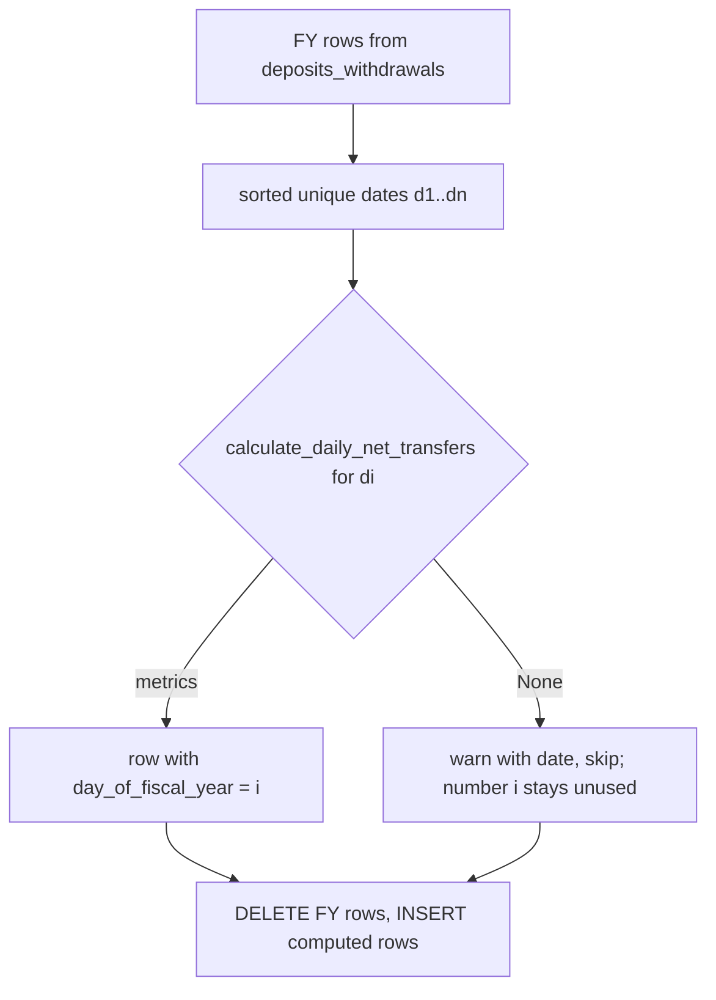
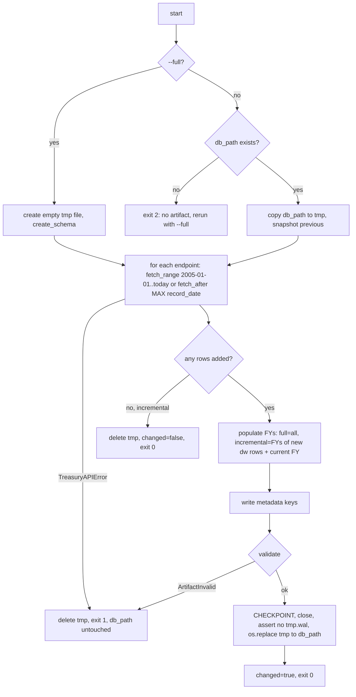

# Phase 2: Ingestion & Data Artifact — ✅ Done

**Goal**: `uv run python -m app.ingest` builds a complete, validated `treasury_data.duckdb`
(full or incremental, all-or-nothing). The first artifact is uploaded to Cloudflare R2, and the
Vercel build downloads and bundles it. The Python cold start is measured against the real file.

## Scope

- In scope: DuckDB schema module, single endpoint registry, hardened Treasury client,
  incremental/full build with fetch-then-swap, `daily_net_transfers` computation with DENSE_RANK
  numbering, validation, metadata keys, tests, R2 bucket setup with `cf`, first upload, Vercel
  env var, cold-start measurement.
- Out of scope: serving queries (Phase 3), scheduling (Phase 4), any HTTP route that writes
  (none will ever exist).

Branch: `feat/ingestion`. `REF` = `/home/hminle/gitrepos/personal-projects/dts-analysis/fullstack_app`.

## Implementation

### 1. Dependencies and settings

```bash
cd backend
uv add --group ingest requests
```

Add to `Settings` in `backend/app/core/config.py` (fields REF had in `REF/backend/app/config.py`
but its client ignored):

```python
treasury_base_url: str = (
    "https://api.fiscaldata.treasury.gov/services/api/fiscal_service"
)
api_page_size: int = 10000
api_throttle_time: float = 0.1
```

Every command that runs ingestion uses `uv run --group ingest ...`; the Vercel install
skips the group, so `requests` stays out of the function bundle.

### 2. `backend/app/constants/endpoints.py` (single registry)

```python
@dataclass(frozen=True)
class EndpointDef:
    key: str           # also the DuckDB table name
    api_path: str
    display_name: str

ENDPOINTS: dict[str, EndpointDef] = {d.key: d for d in (...)}
ENDPOINT_TABLES: tuple[str, ...] = tuple(ENDPOINTS)
DERIVED_TABLES: tuple[str, ...] = ("daily_net_transfers",)
ALL_TABLES: tuple[str, ...] = ENDPOINT_TABLES + DERIVED_TABLES
ACCOUNT_TYPE_TABLES: tuple[str, ...] = ("operating_cash_balance", "deposits_withdrawals")

def table_for(key: str) -> str:
    """Return the table for an endpoint key; raise ValueError if unknown."""
```

The 9 `(key, api_path)` pairs are copied from `REF/backend/app/services/treasury_api.py:23-33`
and the display names from `:336-352` (`get_available_endpoints`), in that order.
`backend/app/constants/__init__.py` re-exports these names. This module imports nothing from
`app/`.

### 3. `backend/app/core/schema.py`

`create_schema(conn: duckdb.DuckDBPyConnection) -> None` — the body of
`REF/backend/app/duckdb_database.py:111-426` (`_init_schema`) verbatim: metadata table, the 10
sequences, the 10 `CREATE TABLE IF NOT EXISTS` statements, the two indexes per table (iterate
`ALL_TABLES` from `app.constants.endpoints`). Drop the try/except-log-reraise wrapper (it adds
nothing). Also define `SCHEMA_VERSION = "1"`.

### 4. `backend/app/utils/fiscal.py` and `backend/app/utils/deposits_withdrawals.py`

- `current_fiscal_year(today: date | None = None) -> int` — `today` defaults to
  `datetime.now(UTC).date()`; returns `today.year + 1` if `today.month >= 10` else `today.year`.
  Docstring examples: `2026-09-30 → 2026`, `2026-10-01 → 2027`.
- `fiscal_year_bounds(fy: int) -> tuple[date, date]` → `(date(fy - 1, 10, 1), date(fy, 9, 30))`.
- `deposits_withdrawals.py`: copy `REF/backend/app/utils/deposits_withdrawals.py` verbatim
  (`calculate_daily_net_transfers`, the net-flow formula: totals exclude Public Debt Cash
  Issues / Redemptions; `net_flow = total_withdrawals − total_deposits`). Do not change the math.

### 5. `backend/app/ingest/treasury_client.py`

Port of `REF/backend/app/services/treasury_api.py` with these differences:

- `class TreasuryAPIError(RuntimeError)`.
- `class TreasuryClient` — `__init__(self, endpoint: EndpointDef, settings: Settings)` builds a
  `requests.Session` once:

  ```python
  retry = Retry(total=3, backoff_factor=1.0,
                status_forcelist=(429, 500, 502, 503, 504),
                allowed_methods=("GET",))
  self._session.mount("https://", HTTPAdapter(max_retries=retry))
  ```

- `fetch_range(start: date, end: date) -> pd.DataFrame` — params
  `filter=record_date:gte:{start},record_date:lte:{end}`, `sort=-record_date`,
  `page[size]=settings.api_page_size`, `page[number]=n`. Loop pages using `meta.total-pages`
  from page 1 (as `fetch_all_pages`, `:92-151`), `time.sleep(settings.api_throttle_time)`
  between pages, `timeout=(5, 60)`. **Any** request error, non-2xx after retries, JSON decode
  error, or missing `data` key raises `TreasuryAPIError` naming the endpoint key and page — REF
  swallows these and returns partial data (`:149-151`), which would publish a truncated
  artifact. Zero rows is a valid result: return an empty DataFrame.
- `fetch_after(latest: date, today: date) -> pd.DataFrame` — `record_date:gt:{latest}` to
  `today`, one pass (REF's dates-only pre-check `:300-312` is dropped; an empty result is cheap).
- `process(rows) -> pd.DataFrame` — `process_data` (`:153-231`) verbatim: `record_date` →
  datetime, numeric coercion for the listed columns and any `*_amt` / `*_bal` column.

### 6. `backend/app/ingest/insert.py`

`insert_frame(conn, df: pd.DataFrame, table: str) -> int` — logic of
`REF/backend/app/duckdb_database.py:615-688`: copy the frame, coerce `record_date`, align to
`DESCRIBE {table}` columns minus `id` (missing → `None`, extra dropped), set `created_at` /
`updated_at` to `datetime.now(UTC)` when absent, `INSERT INTO {table} (cols) SELECT cols FROM
df_copy`. Return `len(df_copy)` (REF's COUNT-before/after delta is removed). Empty frame → `0`.
`table` must be in `ALL_TABLES` (else `ValueError`) since it is interpolated into SQL.

### 7. `backend/app/ingest/populate.py`

- `compute_daily_records(fy_df: pd.DataFrame, fiscal_year: int) -> list[dict]` — port of
  `REF/backend/app/api/treasury/net_transfers.py:180-251` with the numbering change:
  enumerate the **sorted unique** `record_date` strings first; `day_of_fiscal_year = index + 1`
  for every date; when `calculate_daily_net_transfers` returns `None`, `logger.warning` with the
  date and skip the row **without** reusing its number. Remove `tqdm`; log every 50 dates and
  once at the end. Result numbering equals
  `DENSE_RANK() OVER (ORDER BY record_date)` on `deposits_withdrawals` for that FY.
- `populate_fiscal_years(conn, fiscal_years: Iterable[int]) -> dict[int, int]` — for each FY:
  bulk `SELECT * FROM deposits_withdrawals WHERE record_fiscal_year = ?`, compute,
  `DELETE FROM daily_net_transfers WHERE record_fiscal_year = ?`, `insert_frame(...)`. Returns
  `{fy: rows_written}`.



### 8. `backend/app/ingest/validate.py`

`class ArtifactInvalid(RuntimeError)`; `validate(conn, previous: Snapshot | None) -> Snapshot`
where `Snapshot` is a frozen dataclass `{counts: dict[str, int], latest: dict[str, date | None]}`
read from the endpoint tables. Collect every failure, then raise one `ArtifactInvalid` listing
all of them:

- every table in `ENDPOINT_TABLES` has `COUNT(*) > 0`;
- if `previous`: each table's count ≥ previous count and latest date ≥ previous latest;
- for every FY present in `deposits_withdrawals`, `daily_net_transfers` has ≥ 1 row, and its
  `MAX(day_of_fiscal_year)` ≤ the FY's distinct `deposits_withdrawals` date count;
- `metadata` has `build_date`, `latest_record_date`, `source`, `schema_version`.

### 9. `backend/app/ingest/build.py` and `backend/app/ingest/__main__.py`

`build(db_path: Path, *, full: bool, today: date, settings: Settings,
client_factory: Callable[[EndpointDef], TreasuryClient] = default) -> BuildResult`
(`BuildResult` dataclass: `changed: bool`, `records_added: dict[str, int]`,
`fiscal_years_populated: list[int]`, `latest_record_date: str`).



- Temp path: `db_path.with_suffix(".building.duckdb")`; remove a stale one at start.
- `previous` snapshot: whenever `db_path` exists — in **both** modes — open it read-only, take
  `Snapshot` and close it before building. A `--full` rebuild that comes back smaller than the
  live file therefore fails validation instead of shrinking the published data.
- Full fetch starts at `date(2005, 1, 1)` (REF `fetch.py:385-397`).
- Endpoint loop order is `ENDPOINTS` order; one failure aborts the run (no per-endpoint
  catch-and-continue — see README Key Decisions).
- `metadata` writes use `INSERT OR REPLACE INTO metadata (key, value, updated_at)` with
  `build_date = datetime.now(UTC).isoformat()`, `latest_record_date = MAX(record_date)` of
  `deposits_withdrawals` as `YYYY-MM-DD`, `source =
  "https://fiscaldata.treasury.gov/datasets/daily-treasury-statement/"`,
  `schema_version = SCHEMA_VERSION`.
- `CHECKPOINT` then `close()` before `os.replace`: a leftover `.wal` would make the read-only
  open in serving fail or miss data. If `Path(f"{tmp}.wal")` exists after close, raise.

`__main__.py`: `argparse` with `--db PATH` (required), `--full` (flag), `--today YYYY-MM-DD`
(default `datetime.now(UTC).date()`). Configures `logging.basicConfig(level=INFO)`. Calls
`build`, prints the `BuildResult` as one JSON line on stdout. If env `GITHUB_OUTPUT` is set,
appends `changed=true|false` and `latest_record_date=<date>` lines to that file. Exit codes:
`0` success (changed or not), `1` fetch/validation failure, `2` usage error (missing artifact
without `--full`).

### 10. Tests

- `backend/tests/fixtures.py` — row builders returning `pd.DataFrame`:
  - `dw_day(day: date, fy: int, *, deposits: float, withdrawals: float, debt_issues: float,
    debt_redemptions: float) -> pd.DataFrame` emitting 4 `deposits_withdrawals` rows:
    `account_type="Treasury General Account Total Deposits"` and
    `"Treasury General Account Total Withdrawals"` (amounts in `transaction_today_amt`,
    `_mtd_amt`, `_fytd_amt`), and two `account_type="Treasury General Account (TGA)"` rows with
    `transaction_catg="Public Debt Cash Issues (Table IIIB)"` and
    `"Public Debt Cash Redemp. (Table IIIB)"` (labels from
    `REF/backend/app/utils/deposits_withdrawals.py:47,86,126,137`).
  - `dw_day_without_totals(day, fy)` — one unrelated row, so the calculation returns `None`.
  - `endpoint_row(table: str, day: date, fy: int) -> pd.DataFrame` — one minimal row for any
    other endpoint table (just `record_date`, `record_fiscal_year`).
- `backend/tests/test_fiscal.py` — Sep 30 → same year, Oct 1 → next year, bounds of FY2026.
- `backend/tests/test_treasury_client.py` — replace `client._session.get` with a fake: two pages
  → rows concatenated and numeric columns are floats; HTTP 500 response → `TreasuryAPIError`;
  JSON without `data` → `TreasuryAPIError`; zero rows → empty frame.
- `backend/tests/test_ingest_populate.py` — 3 valid days → `day_of_fiscal_year == [1, 2, 3]`
  and `net_flow_today == (withdrawals − debt_redemptions) − (deposits − debt_issues)`; days
  1 and 3 valid, day 2 without totals → two rows numbered `[1, 3]`.
- `backend/tests/test_ingest_build.py` — `client_factory` returns a fake whose
  `fetch_range`/`fetch_after` return fixture frames:
  - `--full` into `tmp_path / "t.duckdb"` → every endpoint table non-empty,
    `daily_net_transfers` populated, 4 metadata keys present, no `.wal`/`.building` files left.
  - incremental with one new day → `records_added["deposits_withdrawals"] == 4`, FY
    re-populated, `changed is True`.
  - incremental with no new rows → `changed is False` and the file's SHA-256 is unchanged.
  - fake raises `TreasuryAPIError` on the 3rd endpoint → exception propagates (or exit 1 via
    `__main__`), original file's SHA-256 unchanged, no temp file left.
  - `--full` rebuild over an existing larger file where the fake returns fewer rows →
    `ArtifactInvalid`, original file's SHA-256 unchanged.

### 11. Bootstrap the real artifact

```bash
cd backend
uv run --group ingest python -m app.ingest --db data/treasury_data.duckdb --full
```

Expect a long first run (all endpoints since 2005; REF's file was ~67 MB). Then sanity-check
against REF semantics:

```bash
uv run python - <<'PY'
import duckdb
c = duckdb.connect("data/treasury_data.duckdb", read_only=True)
print(c.sql("SELECT key, value FROM metadata ORDER BY key"))
print(c.sql("SELECT record_fiscal_year, COUNT(*), MAX(day_of_fiscal_year) FROM daily_net_transfers GROUP BY 1 ORDER BY 1 DESC LIMIT 3"))
PY
```

### 12. Cloudflare R2 (with `cf`)

The user has run `cf auth login` and enabled R2 in the dashboard (prerequisite).

```bash
cf r2 buckets create --name dts-data --location-hint enam
cf r2 buckets domains managed update dts-data --enabled --force
cf r2 buckets domains managed list --bucket-name dts-data   # or read "domain" from the update output
D=$(date -u +%F)
cf r2 objects put "snapshots/$D/treasury_data.duckdb" --bucket-name dts-data \
  --file backend/data/treasury_data.duckdb --content-type application/octet-stream
cf r2 objects put latest/treasury_data.duckdb --bucket-name dts-data \
  --file backend/data/treasury_data.duckdb --content-type application/octet-stream
```

Record the public URL `https://pub-<hash>.r2.dev/latest/treasury_data.duckdb` in
`backend/README.md` (it is not a secret) and set it on Vercel for both environments:

```bash
vercel env add APP_ARTIFACT_URL production    # paste the URL
vercel env add APP_ARTIFACT_URL preview
vercel deploy --prod
```

## Verification

- [x] `uv run ruff check . && uv run ruff format --check . && uv run pytest -q` → all pass,
      no network access (run once with the network disabled, e.g. `unshare -rn uv run pytest -q`).
- [x] Bootstrap run exits 0; `daily_net_transfers` has rows for every FY in
      `deposits_withdrawals`; `MAX(day_of_fiscal_year)` for a complete past FY (e.g. 2025) equals
      `SELECT COUNT(DISTINCT record_date) FROM deposits_withdrawals WHERE record_fiscal_year = 2025`.
- [x] Immediately re-running without `--full` prints `"changed": false` and does not modify the
      file (`sha256sum` before/after equal).
- [x] `uv run --group ingest python -m app.ingest --db /tmp/none.duckdb` → exit code 2 with a
      message telling you to use `--full`.
- [x] With `APP_TREASURY_BASE_URL=https://10.255.255.1` an incremental run fails within ~1 minute
      with exit code 1 and the artifact's SHA-256 is unchanged.
- [x] `curl -sI https://pub-<hash>.r2.dev/latest/treasury_data.duckdb` → `200`, `content-length`
      equals the local file size.
- [x] Vercel `api` build log shows `fetch_artifact: downloaded <n> bytes, latest_record_date=...`;
      `curl -s https://dts-webapp.vercel.app/api/health` → `"data_loaded":true`.
- [x] Cold start measured: wait ≥ 15 minutes idle, then
      `curl -s -o /dev/null -w '%{time_total}\n' https://dts-webapp.vercel.app/api/health`
      three times; record the first (cold) and the next two (warm) timings in Notes.

## Notes

- **Bootstrap (2026-10-18):** 4 min 19 s wall clock, 1.25 GB peak RSS, 867,348 rows across the
  9 tables (deposits_withdrawals 486,609), 49,295,360 bytes, FY2006–FY2027, latest
  `record_date` 2026-10-15. Every date produced metrics (0 skipped); `MAX(day_of_fiscal_year)`
  equals the distinct `deposits_withdrawals` date count in all 22 FYs.
- Network-free test run: `unshare -rn` is not permitted on this machine; ran with
  `HTTPS_PROXY`/`HTTP_PROXY`/`ALL_PROXY` pointed at a dead port instead — 24 passed.
- `requests` is in both the `ingest` and `dev` groups so `uv run pytest` can import the
  client; neither group is installed by Vercel.
- Unreachable Treasury host: exit 1 after 27 s (5 s connect timeout × 4 attempts + backoff),
  artifact SHA-256 unchanged.
- **r2.dev rejects urllib's default User-Agent with 403** (curl is fine). The first deploy with
  `APP_ARTIFACT_URL` set failed its build exactly as designed (previous deployment stayed
  live); `fetch_artifact` now sends `User-Agent: dts-webapp-build/1.0`.
- **`cf r2 objects put` of the ~49 MB file fails intermittently** with `fetch failed`
  (random 20–48 MB probes and the same file under another name succeeded; roughly half of
  the large attempts failed). Uploaded with a retry loop. Phase 4's upload step retries and
  verifies size; its Notes record the S3-API fallback.
- `cf r2 buckets domains managed list` takes `--bucket-name`, not a positional; the `update`
  output already prints the domain. Bucket `dts-data` (ENAM), public domain
  `pub-22cfaba2d9874e799d437ddb6d289fd2.r2.dev`.
- `cf r2 objects delete` needs `--force` in non-interactive shells (otherwise "Aborted.").
- Vercel build: "Bundle size (262.03 MB) exceeds the standard size; optimizing dependencies."
  Under the 500 MB limit; pandas + numpy + duckdb dominate.
- Warm `/api/health` ≈ 0.19–0.33 s. This health route opens neither DuckDB nor pandas, so its
  cold start understates a real data request — re-measure on a data route in Phase 3.
- **Cold start (2026-10-18, after ~20 min idle, production `/api/health`):** 4.80 s cold,
  then 0.38 s and 0.20 s warm. That is above the 4 s threshold even though this route touches
  neither pandas nor DuckDB, so the cost is the Python runtime booting a 262 MB bundle, not
  query work. Carried into Phase 3: re-measure on a real data route, and if it stays > 4 s
  apply the follow-ups above in order (lazy pandas import, function memory/CPU, Phase 4
  warm-up ping). CDN caching (Phase 3) hides this for repeat requests within a deployment.
  **Resolved in Phase 3:** a data route measured 6.80 s cold; app code accounts for < 0.5 s,
  so the fix is a post-deploy CDN warm-up in Phase 4 rather than code changes (see Phase 3
  Notes). If cold > 4 s, the follow-up options (in order) are: lazy-import
  pandas inside the services that need it, then Vercel function memory/CPU settings, then a
  scheduled warm-up ping in Phase 4.
- A DuckDB version bump in `uv.lock` requires re-running the `--full` bootstrap and uploading
  before deploying (file-format compatibility, phase-0 Constraints).
