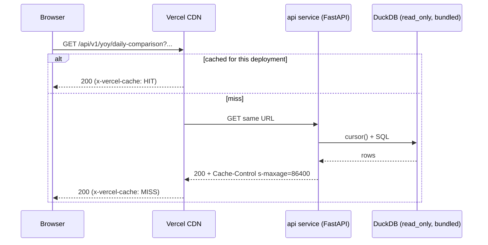

# Phase 3: Serving API — ✅ Done

**Goal**: Every read endpoint of REF is served by a read-only FastAPI app as a cacheable `GET`
(per the phase-0 Endpoint Map), with SQL-side pagination, errors that surface instead of empty
data, tests against a seeded DuckDB file, and a committed OpenAPI contract.

## Scope

- In scope: read-only connection + cursor dependency, cache-header dependency, port of all REF
  query logic into `app/services/`, thin routers, request models as query models, the 503 path
  when no artifact is present, tests, contract regeneration.
- Out of scope: frontend pages (Phases 5–6), any write route, auth/tiers, response-shape
  redesign (shapes stay REF-compatible — phase-0 Constraints).

Branch: `feat/serving-api`. `REF` = `/home/hminle/gitrepos/personal-projects/dts-analysis/fullstack_app`.

## Implementation

### 1. Connection — `backend/app/core/duckdb.py`

```python
class DataUnavailable(RuntimeError):
    """The artifact is missing or unreadable."""

@lru_cache(maxsize=1)
def get_connection() -> duckdb.DuckDBPyConnection:
    path = get_settings().duckdb_path
    if not path.exists():
        raise DataUnavailable(f"No data artifact at {path}")
    # The function filesystem is read-only except /tmp; DuckDB may spill there.
    return duckdb.connect(str(path), read_only=True,
                          config={"temp_directory": "/tmp/duckdb"})
```

Only this module calls `duckdb.connect` in `app/` outside `app/ingest/` (Invariant 1). Add
`reset_connection_for_tests()` that closes and clears the cache (`get_connection.cache_clear()`).

### 2. Dependencies — `backend/app/api/deps.py`

```python
def get_cursor() -> Iterator[duckdb.DuckDBPyConnection]:
    cursor = get_connection().cursor()
    try:
        yield cursor
    finally:
        cursor.close()

CursorDep = Annotated[duckdb.DuckDBPyConnection, Depends(get_cursor)]
```

### 3. Caching — `backend/app/api/caching.py`

```python
# Browsers revalidate after 5 min; Vercel's CDN keeps a day. A deploy (the daily
# data refresh) changes the cache key, so s-maxage can safely be long.
DATA_CACHE_CONTROL = "public, max-age=300, s-maxage=86400, stale-while-revalidate=86400"

def cache_public(response: Response) -> None:
    response.headers["Cache-Control"] = DATA_CACHE_CONTROL
```

Every data router is declared `APIRouter(prefix=..., tags=[...], dependencies=[Depends(cache_public)])`.
`/api/health` is **not** cached (it must reflect the live deployment).

### 4. Errors — `backend/app/main.py`

- `@app.exception_handler(DataUnavailable)` → `JSONResponse(503, {"detail": "Data is not loaded yet"})`.
- `@app.exception_handler(ValueError)` → `JSONResponse(400, {"detail": str(exc)})` — services
  raise `ValueError` for unknown `data_source`, invalid `comparison_mode`, etc.
- No handler for `StarletteHTTPException` (REF needed one only to undo its own blanket 404
  rewrite, `REF/backend/app/main.py:70-90`); FastAPI's default already returns `{"detail"}`.
- Include routers in this order: `health`, `meta`, `lookups`, `data`, `net_transfers`,
  `weekly`, `yoy`, `categories`.

### 5. Shared ports

- `backend/app/constants/categories.py` ← `REF/backend/app/constants/categories.py` verbatim.
- `backend/app/utils/frames.py` ← `REF/backend/app/utils/pydantic_helpers.py`
  (`convert_df_for_pydantic`) verbatim.
- `backend/app/utils/yoy.py` ← `REF/backend/app/utils/yoy.py` verbatim, then remove any
  `try/except` that returns an empty/None result on a query error (Invariant 3).
- `backend/app/schemas/treasury.py` ← `REF/backend/app/schemas/treasury.py`, minus
  `PopulateDailyNetTransfersRequest`, `MetadataResponse`, `FiscalYearRequest`,
  `DateRangeRequest`, and anything only `fetch.py`/populate used. The remaining `*Request`
  models stay — they become query models (§7).
- `backend/app/schemas/meta.py`: `BuildInfo { build_date: str, latest_record_date: str,
  source: str, schema_version: str }`.
- `backend/app/schemas/health.py`: add `latest_record_date: str | None` to `HealthResponse`.

### 6. Services (`backend/app/services/`)

Each service function is sync, takes the cursor first, and returns the response model. Port the
**body** of the REF handler into it; the router only parses parameters and calls it.

| Service function | Ported from | Changes |
|---|---|---|
| `meta.get_stats(cur)` | `REF/.../api/database.py:22-117` | drop per-table `try/except continue`; `last_updated` reads metadata key `build_date` |
| `meta.get_record_counts(cur)` | `database.py:156-179` | same |
| `meta.get_record_counts_by_year(cur)` | `database.py:181-213` | same |
| `meta.get_build_info(cur)` | new | `SELECT key, value FROM metadata WHERE key IN (...)` → `BuildInfo` |
| `lookups.get_account_types(cur, data_source)` | `REF/.../api/treasury/lookups.py:31-76` | unknown `data_source` → `ValueError` via `table_for` |
| `lookups.get_data_sources(cur)` | `lookups.py:78-92` | — |
| `lookups.get_fiscal_years(cur)` | `lookups.py:94-122` | — |
| `lookups.get_categories(cur)` | `lookups.py:124-175` | — |
| `data.list_data(cur, filters, page, page_size)` | `REF/.../api/treasury/data.py:38-138` | **SQL pagination** (§6a) |
| `data.get_data_by_date(cur, date, data_source)` | `data.py:140-185` | per-table loop kept; errors propagate; no rows → 404 detail `No data found for {date}` (keep REF's text if it differs) |
| `net_transfers.get_for_date(cur, date)` | `REF/.../api/treasury/net_transfers.py:78-128` | keep REF's 404 detail text, minus the "run the population task" hint (replace with `Data for this date is not available.`) |
| `net_transfers.get_for_fiscal_year(cur, fiscal_year)` | `net_transfers.py:130-178` | same 404 wording change |
| `weekly.get_comparison(cur, req)` | `REF/.../api/treasury/weekly.py:36-178` | helpers `_fiscal_year_dates`, `_weekly_fridays`, `_build_weekly_points` move with it |
| `yoy.get_category_comparison(cur, req)` | `REF/.../api/treasury/yoy.py:44-203` | remove try/except at `:113-116`; vectorize the `iterrows()` loops only if behavior-identical, else leave and note |
| `yoy.get_daily_comparison(cur, req)` | `yoy.py:205-442` | same |
| `categories.get_major_spending(cur, req)` | `REF/.../api/treasury/major_categories.py:192-253` | helpers `_validate_yoy_request` (raise `ValueError`), `_resolve_yoy_dates`, `_build_subcategory_breakdown` move to this module |
| `categories.get_major_receipts(cur, req)` | `major_categories.py:255-311` | — |
| `categories.get_tbill_interest(cur, req)` | `major_categories.py:313-381` | — |
| `categories.get_irs_tax_refunds(cur, req)` | `major_categories.py:383-456` | — |
| `categories.get_daily_yoy(cur, req)` | `major_categories.py:458-625` | — |

Where REF raised `HTTPException(404, ...)` inside a handler, the service raises
`HTTPException(404, ...)` too (it is fine for services to raise it here — there is no other
caller). Where REF raised `HTTPException(400, ...)`, raise `ValueError` with the same text.

#### 6a. SQL pagination — `data.list_data`

```python
def _paginated_union(cur, tables: list[str], where_for: Callable[[str], tuple[str, list]],
                     page: int, page_size: int) -> tuple[list[dict], int]:
```

- Count: `SELECT COUNT(*) FROM {t} WHERE {where}` per table, summed.
- Rows: one statement
  `SELECT * FROM (<branch_1> UNION ALL BY NAME <branch_2> ...) ORDER BY record_date DESC, data_source, id LIMIT ? OFFSET ?`
  where each branch is `SELECT *, '{t}' AS data_source FROM {t} WHERE {where_t}`; parameters
  repeat per branch, then `page_size`, `(page - 1) * page_size`. `UNION ALL BY NAME` fills
  columns a table lacks with NULL (REF used `pd.concat` for that). The `data_source, id`
  tiebreak makes pages stable; REF's pandas order on equal dates was arbitrary.
- `where_for(t)` reproduces REF exactly: `account_type = ?` only for tables in
  `ACCOUNT_TYPE_TABLES` (others ignore the filter, as REF did — `data.py:79-83`),
  `record_fiscal_year = ?`, `record_date >= ?`, `record_date <= ?`.
- Tables: `[table_for(data_source)]` when given, else `ALL_TABLES` (REF included
  `daily_net_transfers`; keep that).
- Convert the page with `convert_df_for_pydantic`; `pages = ceil(total / page_size)` or 0.

### 7. Routers (`backend/app/api/routers/`)

Every handler is `def` (not `async def` — Invariant 2), takes `cur: CursorDep`, and returns
the service result with the REF `response_model`. Request models become query models:

```python
@router.get("/comparison", response_model=WeeklyComparisonResponse)
def get_comparison(cur: CursorDep, req: Annotated[WeeklyComparisonRequest, Query()]):
    return weekly.get_comparison(cur, req)
```

List fields arrive as repeated keys: `?category_descriptions=A&category_descriptions=B`.

| File | Prefix / tag | Routes (function name → path) |
|---|---|---|
| `meta.py` | `/api/v1/meta` / `meta` | `get_stats` `/stats`, `get_record_counts` `/record-counts`, `get_record_counts_by_year` `/record-counts-by-year`, `get_build` `/build` |
| `lookups.py` | `/api/v1/lookups` / `lookups` | `get_account_types` `/account-types` (`data_source: str \| None`), `get_data_sources` `/data-sources`, `get_fiscal_years` `/fiscal-years`, `get_categories` `/categories` |
| `data.py` | `/api/v1/data` / `data` | `list_data` `""` (REF query params `page`, `page_size` ≤ 1000, `data_source`, `account_type`, `fiscal_year`, `start_date`, `end_date`), `get_by_date` `/date/{date}` (`data_source`) |
| `net_transfers.py` | `/api/v1/net-transfers` / `net_transfers` | `get_for_date` `/date/{date}`, `get_for_fiscal_year` `/fiscal-year/{fiscal_year}` |
| `weekly.py` | `/api/v1/weekly` / `weekly` | `get_comparison` `/comparison` (`WeeklyComparisonRequest`) |
| `yoy.py` | `/api/v1/yoy` / `yoy` | `get_category_comparison` `/category-comparison`, `get_daily_comparison` `/daily-comparison` |
| `categories.py` | `/api/v1/categories` / `categories` | `get_major_spending` `/major-spending`, `get_major_receipts` `/major-receipts`, `get_tbill_interest` `/tbill-interest`, `get_irs_tax_refunds` `/irs-tax-refunds`, `get_daily_yoy` `/daily-yoy` |

`health.py`: `data_loaded` / `latest_record_date` come from `get_connection()` + metadata;
catch `DataUnavailable` only here (health must answer without data) → `data_loaded=False`.



### 8. Tests

- `backend/tests/conftest.py`: session-scoped fixture `seeded_db(tmp_path_factory)` builds a
  DuckDB file with `create_schema`, inserts fixture rows (`tests/fixtures.py`) for FY2025 and
  FY2026 — at least 3 `deposits_withdrawals` days per FY across 2 different weeks, one row per
  other endpoint table, `daily_net_transfers` via `populate_fiscal_years`, and the 4 metadata
  keys — then `CHECKPOINT`s and closes. Fixture `client(seeded_db, monkeypatch)` sets
  `APP_DUCKDB_PATH`, clears `get_settings` and `reset_connection_for_tests()`, yields
  `TestClient(app)`. Fixture `empty_client` points at a missing file.
- `test_meta_api.py`: stats `record_count` equals the seeded total; `last_updated` equals the
  seeded `build_date`; `/build` returns all 4 keys.
- `test_lookups_api.py`: fiscal years `[2026, 2025]`; `account-types?data_source=nonsense` → 400.
- `test_data_api.py`: `page_size=2` paging covers all rows exactly once, no duplicates; page 2's
  first `record_date` ≤ page 1's last; `total` constant across pages; `data_source` filter;
  `account_type` filter excludes non-account-type tables' rows only when `data_source` is that
  table (REF semantics); `/data/date/1999-01-01` → 404; `data_source=nonsense` → 400.
- `test_net_transfers_api.py`: FY2026 list `day_of_fiscal_year` is `1..n`; unknown date → 404
  with the new detail text.
- `test_analysis_api.py`: smoke each of `weekly/comparison`, `yoy/category-comparison`
  (two `category_descriptions`), `yoy/daily-comparison` (`metric=net_flow`), and all five
  `categories/*` routes with FY2026 vs FY2025 → 200 and the response validates against its
  model; `comparison_mode=bogus` → 400.
- `test_caching.py`: a data route's `Cache-Control` equals `DATA_CACHE_CONTROL`;
  `/api/health` has no `s-maxage`; every route in `app.routes` under `/api/v1` has
  `methods == {"GET"}` (guards Invariant 2 against regressions); `empty_client` → `/api/v1/meta/stats`
  is 503 and `/api/health` is 200 with `data_loaded: false`.

### 9. Contract

```bash
cd backend && uv run python -m scripts.export_openapi
cd ../frontend && pnpm gen:api && pnpm typecheck
```

## Verification

- [x] `uv run ruff check . && uv run ruff format --check . && uv run pytest -q` → pass.
- [x] `grep -rn "duckdb.connect" backend/app | grep -v -e app/core/duckdb.py -e app/ingest/` → no output.
- [x] `grep -rn "async def" backend/app/api/routers` → no output.
- [x] `grep -rn "except Exception" backend/app/services backend/app/api` → no output.
- [x] Parity against REF on the bootstrap artifact: copy it
      (`cp backend/data/treasury_data.duckdb /tmp/ref.duckdb` — REF opens read-write and
      DuckDB's file lock would block this app's read-only open of the same file), start REF's
      backend on :8001 with `DUCKDB_PATH=/tmp/ref.duckdb uv run uvicorn app.main:app --port 8001`
      in `REF/backend`, and this backend on :8000; for FY2025 vs FY2024 compare
      `POST :8001/api/v1/treasury/data/weekly-comparison` with
      `GET :8000/api/v1/weekly/comparison?...`, and likewise one `yoy/*` and one
      `categories/*` route — bodies equal after `jq -S` (allowed diff: `day_of_fiscal_year`
      on FYs where REF skipped dates).
- [x] `time curl -s 'localhost:8000/api/v1/data?page=200&page_size=50' >/dev/null` < 300 ms on
      the full artifact.
- [x] `docs/contracts/openapi.json` lists exactly the paths in the phase-0 Endpoint Map and
      operation ids like `yoy_get_daily_comparison`; `git diff` on it is committed with the code.
- [x] After `vercel deploy --prod`: requesting
      `https://dts-webapp.vercel.app/api/v1/lookups/fiscal-years` twice → second response has
      `x-vercel-cache: HIT`.

## Notes

- **Parity (2026-10-18, REF on a copy of the bootstrap artifact, same DuckDB 1.5.6 / pandas
  2.3.3):** 19 of 20 compared routes returned identical JSON (weekly, both YoY routes incl.
  `calendar_date` mode, all five category routes, both net-transfer routes, data by date, the
  four lookups, record counts, counts by year). The one difference is sanctioned:
  `stats.last_updated` was always `null` in REF (it read a key nothing wrote) and is now the
  build date. `/data` totals match (872,632 rows, 17,453 pages); page 1 row sets differ only
  because all its rows share one date — REF's order among ties was arbitrary, ours is
  `record_date DESC, data_source, id`. No `day_of_fiscal_year` differences: the bootstrap had no
  skipped dates.
- The REF handlers were ported by a scripted transform (strip router/`Depends`, connection →
  cursor parameter, 400 → `ValueError`, remove `try/except` blocks that returned `[]` or a
  generic 500 — 3 in `yoy.py`, 0 in `major_categories.py`), then reviewed. `iterrows()` loops
  were left as they are (behavior-identical vectorization is not needed at this data size).
- `get_data_by_date` keeps REF's table-by-table output order via an internal `_table_order`
  column. A new `data_table_for` resolver accepts derived tables: REF's `data_source=
  daily_net_transfers` silently fell back to `deposits_withdrawals`.
- FastAPI 0.146 wraps included routers in `app.routes` (`_IncludedRouter`); the GET-only
  guard test inspects `app.openapi()` instead.
- Latency, local: `/data?page=200` 237 ms; every other route ≤ 245 ms. **Production (cache
  MISS):** filtered paging as the Fiscal year page uses it (`fiscal_year` [+ `data_source`])
  0.19–0.35 s at pages 1 and 40; YoY/category routes 0.22–0.69 s; **unfiltered** `/data`
  across all ten tables 1.0–1.4 s warm (6.2 s on a fresh instance) — slower function CPU on a
  full sort; no page requests that shape.
- CDN: second request → `x-vercel-cache: HIT`. Vercel strips `s-maxage` /
  `stale-while-revalidate` from the browser-facing header (documented behavior), so browsers
  see `public, max-age=300`.
- **Cold start on a data route (2026-10-18, ~18 min idle, unique query to bypass the CDN):**
  `/api/v1/net-transfers/fiscal-year/2025` 6.80 s cold, then 0.33 s / 0.34 s warm. Locally,
  `import app.main` takes 0.44 s (pandas 0.17 s, FastAPI 0.19 s) and DuckDB open + first
  query 12 ms — so ~6 s of the cold start is Vercel loading the 262 MB bundle and booting
  Python, not app code. **Decision:** skip lazy pandas imports (saves well under a second) and
  function-size tuning; instead Phase 4 warms the CDN after every deploy by requesting each
  page's default URLs, so visitors almost always get a cache HIT. Revisit bundle size if cold
  misses show up in practice (Vercel logs, `x-vercel-cache: MISS` on page defaults).
