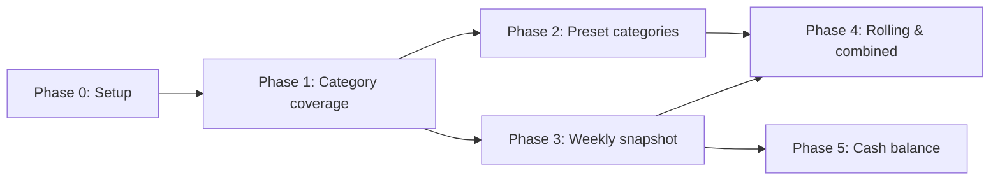

# Fiscal Briefing — Weekly Snapshot, More Categories, Leading Flows, Cash Balance

The weekly *MMT Trader* newsletter builds its fiscal briefing from the same Treasury
statements this app serves. Every figure in its Fiscal Flows section reproduces from our data
(`docs/research/mmt-trader-dts-method.md`). This plan closes the gaps between the two:
- 14 more preset categories
- a weekly snapshot page, read on Thursday or Friday
- 10-statement rolling averages with a projected monthly rate
- two combined figures
- the Treasury's cash balance

It first fixes a gap the research uncovered: categories silently compare against zero across
the Treasury's line renames. GDP comparisons are out of scope.

## Status

| Phase | Status | Description |
|-------|--------|-------------|
| Phase 0: Setup | ✅ Done | Existing state, Treasury line history, contracts, worked examples, decisions |
| Phase 1: Category coverage | ⬜ Not Started | `available_from` per category; old line names summed; totals before coverage are `null`, not 0 |
| Phase 2: Preset categories | ⬜ Not Started | 10 spending + 4 receipt categories, two endpoints, "Other categories" grids |
| Phase 3: Weekly snapshot | ⬜ Not Started | `/snapshot` page + `snapshot_get_weekly`; Thursday/Friday anchor, also on the weekly comparison |
| Phase 4: Rolling averages & combined figures | ⬜ Not Started | 10-statement averages (× 20 monthly rate), interest income transfers, net customs receipts; `/daily/leading-flows` |
| Phase 5: Cash balance | ⬜ Not Started | TGA closing balance across three storage eras; `/cash-balance` page and snapshot card |

## Phase Dependencies

Phases 2 and 3 both need only Phase 1, so they can run in parallel. Phases 4 and 5 can also
run in parallel once Phase 3 has landed (Phase 4 also needs Phase 2). They add different
fields to the snapshot.

## Key Decisions

- **Coverage first.** The Treasury renamed or restructured most lines between 2019 and 2023.
  Today a renamed line counts as 0 for older years.
  - **Renames.** Lines whose FYTD carries forward are merged, by adding the old names to
    `components`.
  - **Restructures.** These set `available_from`. Totals before that date are `null`, and the
    UI says "Comparable from …".

  The evidence is Phase 0's line-history table.
- **New categories are "other", not "major".** They get two new endpoints with the existing
  response models, and their own grid under the major grid. Each card carries its own formula
  id.
- **Snapshot = latest completed week.** The anchor weekday is Thursday by default (as in the
  newsletter) or Friday. After a holiday the snapshot uses the closest earlier statement
  within 5 days, the weekly comparison's existing rule. The previous year is lined up by
  `day_of_fiscal_year`. An `as_of` parameter makes any past week readable.
- **The gap change stays inside one fiscal year.** It is `null`, with a reason, when last week
  belongs to the previous fiscal year.
- **Rolling windows count statements, not days.** The monthly projection is × 20, the
  newsletter's rule of thumb, and it is labelled as such.
- **Combined figures are signed sums of registry categories.** They are comparable from the
  latest `available_from` of their terms.
- **One cash-balance rule.** Three eras live in a constant. Since 2022-04-18 the closing
  balance sits in `open_today_bal`. A NULL balance raises instead of being skipped.
- **We do not copy the newsletter's errors.** Totals and changes always use the same lines.
  The newsletter's HUD/SNAP changes use one line where the total uses two.

## How to Resume

1. Read this README for current status.
2. Read `phase-0-setup.md`: the line-history and cash-balance tables, the contracts, the file
   inventory and the worked examples.
3. Open the current 🔄 In Progress or 🔁 Rework phase file. If there is none, open the first
   ⬜ Not Started phase whose dependencies are ✅ Done.
4. `explainer.html` is the human briefing. Its walkthrough steps flip to "Live" as phases land.
