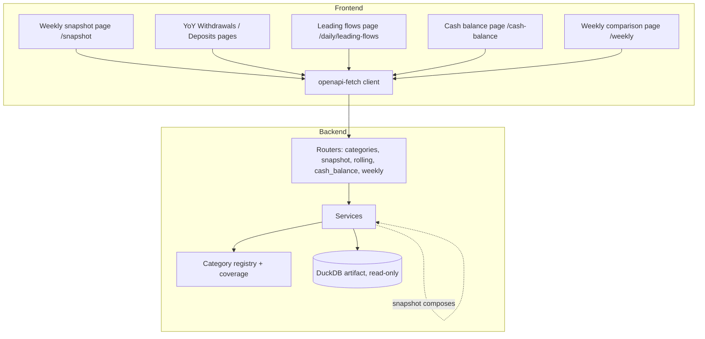

# Phase 0: Setup — ✅ Done

**Goal**: Fix the existing state, architecture, contracts, decisions and file inventory that
Phases 1–5 build on.

## Existing State

Findings from the codebase and the live artifact on 2026-10-25 (`main` at `4042b73`).

### Where this plan comes from

`docs/research/mmt-trader-dts-method.md` reverse-engineers the weekly *MMT Trader*
newsletter. Every figure in its Fiscal Flows section reproduces from our data. The gaps
between that newsletter and the app are the scope of this plan:

1. Preset categories.
2. A weekly snapshot page, with a Thursday or Friday weekday choice.
3. Rolling averages and combined figures.
4. A chart of the Treasury's cash balance.

GDP comparisons are out of scope.

### Reused as-is

- **Category registry.** `backend/app/constants/categories.py:28` `CategoryDef(name, kind,
  components)`; `MAJOR_SPENDING_CATEGORIES` (line 36, 4 groups), `MAJOR_RECEIPT_CATEGORIES`
  (line 68, 2 groups), `TBILL_INTEREST_CATEGORY` (line 93), `IRS_REFUND_CATEGORY` (line 106),
  `CATEGORY_REGISTRY` (line 122) keyed by display name.
- **Category service.** `backend/app/services/categories.py`:
  - `FYTDSource` descriptors are defined at lines 54–75.
  - `_validate_yoy_request` (line 81), `_resolve_yoy_dates` (line 99) and
    `_build_subcategory_breakdown` (line 133) are shared by `get_major_spending` (167) and
    `get_major_receipts` (228).
  - `get_daily_yoy` (line 427) dispatches by `CATEGORY_REGISTRY`, so **any category added to
    the registry gets a working detail chart for free**.
- **YoY helpers.** `backend/app/utils/yoy.py`: `latest_date_for_fy` (70),
  `find_aligned_previous_date` (139), `fetch_component_fytd` (200, returns `0.0` for a missing
  row), `yoy_change` (255, `delta / |previous| × 100`, `None` when previous is 0).
- **Pre-computed net transfers.** Table `daily_net_transfers` (built by
  `backend/app/ingest/populate.py`) has `record_date`, `record_fiscal_year`,
  `day_of_fiscal_year`, `total_deposits_{today,mtd,fytd}`, `total_withdrawals_{today,mtd,fytd}`,
  `net_flow_{today,mtd,fytd}`, `leading_flow`. Read through
  `backend/app/services/net_transfers.py`.
- **Weekly comparison.** `backend/app/services/weekly.py`: `_weekly_fridays` (line 31,
  hard-coded `weekday() != 4`) and `_build_weekly_points` (line 45, 5-day look-back for a
  holiday). Router `backend/app/api/routers/weekly.py`. Request
  `WeeklyComparisonRequest` in `backend/app/schemas/treasury.py:93`.
- **Router conventions.** Every router is `APIRouter(prefix="/api/v1/<area>", tags=["<area>"],
  dependencies=[Depends(cache_public)])`. Routes take `CursorDep` and
  `Annotated[Model, Query()]`, and stay thin (`backend/app/api/routers/categories.py`). Routers
  are registered in `backend/app/main.py:58`. Operation id is `"{tag}_{function_name}"`
  (`main.py:23`).
- **Error mapping.** `main.py:51` maps `ValueError` → 400. Services raise
  `HTTPException(404)` for "no data".
- **Frontend category UI.** These files live in `frontend/src/features/yoy/`:
  - `lib.ts`: `CategoryCardData`, `spendingCards`, `receiptCards`, `breakdownRows`.
  - `components/category-grid.tsx`: `CategoryGrid` and `periodDescription`.
  - `components/category-card.tsx`: `CategoryCard`, and `CATEGORY_FORMULA`, which maps a kind
    to a formula.
  - `components/category-detail-dialog.tsx`: the daily chart and the breakdown table.
  - `components/spending-categories-section.tsx` and `receipt-categories-section.tsx`.

  The pages `withdrawals-page.tsx` and `deposits-page.tsx` render those sections through
  `YoYAnalysisLayout.renderCategoriesSection`.
- **Formula registry.** `frontend/src/features/methodology/formulas.ts` has `FormulaId`
  (line 6, 17 ids), `FORMULAS` and `FORMULA_ORDER` (line 363). `formulas.test.ts:64` checks
  that every `terms[].meaning` of `major-spending`, `major-receipts`, `tbill-interest` and
  `irs-refunds` appears quoted in `backend/app/constants/categories.py`. The Methodology page
  (`methodology-page.tsx`) renders `<FormulaBlock id=…/>` inside numbered `ProseSection`s; its
  TOC list is at line 52.
- **Worked examples.** The canonical copy is
  `frontend/src/features/methodology/worked-examples.json`. It is checked by
  `backend/tests/test_formula_examples.py` and copied byte-for-byte to
  `backend/app/mcp_server/worked-examples.json`; `test_mcp_skills.py::test_worked_examples_copy_matches_frontend`
  enforces the copy.
- **MCP skills.** `backend/app/mcp_server/skills.py:110` `_render_categories()` renders
  `{{categories}}` in `skills/categories.md` from `CATEGORY_REGISTRY`. New operations appear in
  `list_api`/`call_api` automatically (they read `app.openapi()`).
- **Shared UI.**
  - `frontend/src/components/stat-card.tsx` `StatCard(title, value, note, hint)`
  - `components/page.tsx` `Page(title)`
  - `components/query-state.tsx` `QueryState`
  - `components/charts/chart-controls.tsx`
  - `components/ui/` has `toggle-group`, `select`, `input` and `chart`
  - `lib/format.ts`: `formatBillions`, `formatPercent`, `formatSignedPercent`, `formatDate`,
    `formatShortDate`
  - `lib/chart.ts` `SERIES`
- **Navigation.** `frontend/src/components/layout/data/sidebar-data.ts` `MENU_ITEMS`.
- **Tests.**
  - `backend/tests/fixtures.py`: `formula_db(frames)` builds an in-memory artifact with the
    real schema. `catg_row`, `dw_row`, `dw_day`, `apd_row` and `itr_row` are row builders.
  - `backend/tests/conftest.py`: the seeded `client` artifact has 3 days per FY: 2024-10-01,
    10-04, 10-11 and 2025-10-01, 10-03, 10-10. The 2025 dates are a Wednesday and two Fridays,
    so **a Thursday anchor finds no statement in the seed**. Thursday tests use `formula_db`.

### Partially exists (this plan integrates with it)

- **Coverage of renamed lines is silently zero.** `fetch_component_fytd` returns `0.0` when a
  line is absent. The Treasury has renamed or restructured many lines mid-year (table below),
  so today's existing cards compare a real FYTD with zero for older years. For example,
  Social Security for FY2021 vs FY2020 reads 0 for every day before 2021-07-19. Phase 1 fixes
  this for every category before Phase 2 adds 14 more.
- **The cash balance is ingested but never shown.** `operating_cash_balance` is in
  `ENDPOINTS` (`backend/app/constants/endpoints.py:21`) and in the artifact, but no service
  reads it.

### Absent (this plan creates it)

- Any weekly snapshot, any rolling average, any combined (cross-category) figure, and any
  cash-balance endpoint or page.

### Treasury line history (verified against the artifact)

A rename **carries the FYTD forward** when the new name's first FYTD continues the old name's
last one. Those old names are added to `components`. On any one date only one of the names
exists, so the sum never double-counts. A **restructure** does not carry forward: lines were
split or merged. For those, the category gets an `available_from` date and is not compared
before it.

| Line(s) | Change | Date | Carries forward? | Evidence (FYTD before → after) |
|---|---|---|---|---|
| `Customs and Certain Excise Taxes` → `DHS - Customs and Certain Excise Taxes` | rename | 2020-05-11 | ✅ | 52,799 → 52,895 |
| `DHS - Customs and Certain Excise Taxes` → `DHS - Customs Duties, Taxes, and Fees` | rename | 2025-11-10 | ✅ | 36,282 → 36,690 |
| `Medicaid` → `HHS - Grants to States for Medicaid` | rename | 2020-03-09 | ✅ | 179,486 → 181,474 |
| `Medicare Advantage…` + `Medicare and Other CMS Payments` → 3 HHS lines | restructure | 2020-03-09 | ❌ | 363,869 → 361,750 (+11,609 elsewhere) |
| `Social Security Benefits (EFT)` → `SSA - Benefits Payments` + SSI + SSA misc | restructure | 2021-07-19 | ❌ (SSI, misc are new) | 790,545 → 790,602 + 45,606 + 3,718 |
| `Education Department programs` → `Dept of Education (ED)` | rename | 2019-11-12 | ✅ | W 16,861 → 17,377; D 8,247 → 8,562 |
| `Marketplace Payments` → `HHS - Marketplace Payments` | rename | 2020-03-09 | ✅ | 25,947 → 25,947 |
| `Housing and Urban Development programs` → HUD misc + FHA | rename (split) | 2022-05-16 | ✅ | 51,527 → 40,986 + 10,682 |
| `Supple. Nutrition Assist. Program (SNAP)` → `USDA - Supp Nutrition Assist Prog (SNAP)` (+ WIC split out) | restructure | 2020-11-16 | ❌ (WIC new) | — |
| `Unemployment Insurance Benefits` → `DOL - Unemployment Benefits` | rename | 2020-09-21 | ✅ | 460,474 → 462,445 |
| `Veterans Affairs programs` → `Dept of Veterans Affairs (VA)`; `VA - Benefits` new | restructure | 2020-01-13 | ❌ | — |
| `Defense Vendor Payments (EFT)` → DoD misc, DoD Health, Military pay lines | restructure | 2023-10-02 (FY2024 start) | ❌ | 382,713 (FY23 end) → new FY |
| `Public Debt Cash Issues (Table III-B)` → `(Table IIIB)` | rename | 2022-09-12 | ✅ | 16,767,375 → 16,768,840 |
| Withheld, corporate and non-withheld taxes move from `federal_tax_deposits` into `deposits_withdrawals` | restructure | 2023-02-14 | ❌ | non-withheld 129,940 → 241,021 |
| `Discount on New Issues` → `Bills (-)` + `Bonds and Notes (-)` (`adjustment_public_debt`) | restructure | 2022-09-12 | ❌ | — |
| Refund types `IRS Tax Refunds …` → `Taxes - … Tax Refunds (EFT/Checks)` (`income_tax_refunds`) | restructure | 2023-02-14 | ❌ | — |
| `DHS - Customs & Border Protection (CBP)` (withdrawal) | new line | 2020-05-11 | — | — |

### Cash balance history (`operating_cash_balance`)

The Treasury General Account (TGA) closing balance lives on three different rows over time.
Each was checked for continuity: each era's last close equals the next era's first open.

| Dates | `account_type` | Column holding the closing balance |
|---|---|---|
| 2005-10-03 → 2021-09-30 | `Federal Reserve Account` | `close_today_bal` |
| 2021-10-01 → 2022-04-15 | `Treasury General Account (TGA)` | `close_today_bal` |
| 2022-04-18 → today | `Treasury General Account (TGA) Closing Balance` | **`open_today_bal`** (`close_today_bal` is NULL) |

Continuity: 2021-09-30 close 215,160 = 2021-10-01 open 215,160; 2022-04-15 close 578,473 =
2022-04-18 `TGA Opening Balance` 578,473. Check value: 2026-08-27 closing = 950,804, which the
newsletter prints as "$950.8 bln". Before 2012 the Treasury also held cash in Tax and Loan
Note accounts; the chart shows the Federal Reserve account only.

## Architecture



The snapshot service is a composer: it calls the category, rolling and cash-balance services
for one date instead of re-implementing their maths.

## Contracts (all `GET`, all cached by `cache_public`)

| Phase | Operation id | Path | Request model | Response model |
|---|---|---|---|---|
| 1 | (existing) `categories_get_major_spending`, `categories_get_major_receipts`, `categories_get_tbill_interest`, `categories_get_irs_tax_refunds`, `categories_get_daily_yoy` | unchanged | unchanged | **fields become nullable, `available_from` added** |
| 2 | `categories_get_other_spending` | `/api/v1/categories/other-spending` | `MajorSpendingCategoriesRequest` | `MajorSpendingCategoriesResponse` |
| 2 | `categories_get_other_receipts` | `/api/v1/categories/other-receipts` | `MajorReceiptCategoriesRequest` | `MajorReceiptCategoriesResponse` |
| 3 | `snapshot_get_weekly` | `/api/v1/snapshot/weekly` | `WeeklySnapshotRequest` | `WeeklySnapshotResponse` |
| 3 | (existing) `weekly_get_comparison` | unchanged | **+ `anchor_weekday`** | unchanged |
| 4 | `rolling_get_daily` | `/api/v1/rolling/daily` | `RollingAverageRequest` | `RollingAverageResponse` |
| 4 | `categories_get_combined` | `/api/v1/categories/combined` | `MajorSpendingCategoriesRequest` | `CombinedCategoriesResponse` |
| 5 | `cash_balance_get_daily` | `/api/v1/cash-balance/daily` | `CashBalanceRequest` | `CashBalanceResponse` |

Every phase that changes a contract ends with:

```bash
cd backend && uv run python -m scripts.export_openapi   # rewrites docs/contracts/openapi.json
cd ../frontend && pnpm gen:api                           # rewrites src/lib/api/schema.d.ts
```

## File inventory by phase

**Phase 1 — Category coverage**
- Modify `backend/app/constants/categories.py`, `backend/app/services/categories.py`,
  `backend/app/utils/yoy.py`, `backend/app/schemas/treasury.py`,
  `backend/app/mcp_server/skills.py`, `backend/app/mcp_server/skills/categories.md`,
  `backend/tests/test_formula_categories.py`, `backend/tests/test_mcp_skills.py`
- Modify `frontend/src/features/yoy/lib.ts`, `lib.test.ts`,
  `components/category-card.tsx`, `components/category-detail-dialog.tsx`,
  `components/breakdown-table.tsx` (only if it reads totals),
  `frontend/src/features/methodology/formulas.ts`, `methodology-page.tsx`
- Regenerate `docs/contracts/openapi.json`, `frontend/src/lib/api/schema.d.ts`

**Phase 2 — Preset categories**
- Modify `backend/app/constants/categories.py`, `backend/app/services/categories.py`,
  `backend/app/api/routers/categories.py`, `backend/tests/test_formula_categories.py`,
  `backend/tests/test_analysis_api.py`
- Create `frontend/src/features/yoy/components/other-spending-section.tsx`,
  `other-receipts-section.tsx`
- Modify `frontend/src/features/yoy/api.ts`, `lib.ts`, `lib.test.ts`,
  `components/category-card.tsx`, `components/category-detail-dialog.tsx`,
  `withdrawals-page.tsx`, `deposits-page.tsx`, `features/methodology/formulas.ts`,
  `formulas.test.ts`, `methodology-page.tsx`
- Regenerate the contract and client

**Phase 3 — Weekly snapshot**
- Create `backend/app/services/snapshot.py`, `backend/app/api/routers/snapshot.py`,
  `backend/app/utils/anchor.py`, `backend/tests/test_formula_snapshot.py`,
  `backend/tests/test_snapshot_api.py`
- Modify `backend/app/main.py`, `backend/app/schemas/treasury.py`,
  `backend/app/services/weekly.py`, `backend/app/services/categories.py` (`_source_for`,
  `category_fytd`), `backend/app/api/routers/weekly.py`, `backend/tests/fixtures.py`
  (`dnt_row`), `backend/tests/test_formula_weekly.py`, `backend/tests/test_formula_examples.py`
- Create `frontend/src/routes/snapshot.tsx`, `frontend/src/features/snapshot/{api.ts,lib.ts,lib.test.ts,snapshot-page.tsx}`,
  `frontend/src/features/snapshot/components/{snapshot-header.tsx,figure-card.tsx}`,
  `frontend/src/components/anchor-weekday-select.tsx`
- Modify `frontend/src/components/layout/data/sidebar-data.ts`,
  `frontend/src/features/weekly/{api.ts,weekly-page.tsx}`,
  `frontend/src/features/methodology/{formulas.ts,methodology-page.tsx,worked-examples.json}`,
  `backend/app/mcp_server/worked-examples.json` (copy)
- Regenerate the contract, the client, and `frontend/src/routeTree.gen.ts` (`pnpm build`)

**Phase 4 — Rolling averages & combined figures**
- Create `backend/app/services/rolling.py`, `backend/app/api/routers/rolling.py`,
  `backend/tests/test_formula_rolling.py`, `backend/tests/test_formula_combined.py`
- Modify `backend/app/constants/categories.py`, `backend/app/services/categories.py`,
  `backend/app/api/routers/categories.py`, `backend/app/services/snapshot.py`,
  `backend/app/schemas/treasury.py`, `backend/app/main.py`,
  `backend/app/mcp_server/skills/categories.md`, `backend/tests/test_formula_examples.py`,
  `backend/tests/test_formula_snapshot.py`, `backend/tests/test_analysis_api.py`
- Create `frontend/src/routes/daily/leading-flows.tsx`,
  `frontend/src/features/daily/leading-flows-page.tsx`,
  `frontend/src/features/daily/components/rolling-chart.tsx`,
  `frontend/src/features/daily/lib.ts` additions (`rangeStart`) + `lib.test.ts`
- Modify `frontend/src/features/daily/api.ts`, `frontend/src/features/snapshot/*`,
  `sidebar-data.ts`, `formulas.ts`, `formulas.test.ts`, `methodology-page.tsx`, both
  `worked-examples.json`
- Regenerate the contract, client and route tree

**Phase 5 — Cash balance**
- Create `backend/app/constants/cash_balance.py`, `backend/app/services/cash_balance.py`,
  `backend/app/api/routers/cash_balance.py`, `backend/tests/test_formula_cash_balance.py`
- Modify `backend/app/main.py`, `backend/app/schemas/treasury.py`,
  `backend/app/services/snapshot.py`, `backend/tests/fixtures.py` (`ocb_row`),
  `backend/tests/test_formula_snapshot.py`, `backend/tests/test_formula_examples.py`,
  `backend/tests/test_analysis_api.py`, `backend/app/mcp_server/skills/data-model.md`
- Create `frontend/src/routes/cash-balance.tsx`,
  `frontend/src/features/cash-balance/{api.ts,lib.ts,lib.test.ts,cash-balance-page.tsx}`
- Modify `sidebar-data.ts`, `frontend/src/features/snapshot/*`, `formulas.ts`,
  `methodology-page.tsx`, both `worked-examples.json`
- Regenerate the contract, client and route tree

## Worked examples (real statements, used in tests and the Methodology page)

All numbers are millions of dollars from the live artifact.

| Example | Current | Previous | Result |
|---|---|---|---|
| Snapshot, Thursday 2025-12-04 (FY2026 day 44) vs 2024-12-04 (FY2025 day 44) | withdrawals 1,432,895; deposits 957,420; net 475,475; withholding 591,734; MTD withdrawals 200,188; MTD net 120,817 | 1,404,753; 817,202; 587,551; 568,727 | +28,142 (+2.0%); +140,218 (+17.16%); −112,076 (−19.08%); +23,007 (+4.05%) |
| Previous week: Thursday 2025-11-27 is Thanksgiving → Wednesday 2025-11-26 (day 39) vs 2024-11-26 (day 39) | net 363,450 | 453,029 | gap −89,579; week-over-week gap change −22,497 (wider) |
| 10-day average of withdrawals ending 2025-12-04 | 19,815; 31,192; 16,793; 19,998; 54,507; 13,595; 125,763; 13,764; 44,733; 15,928 | — | Σ 356,088 ÷ 10 = 35,608.8; × 20 = 712,176 |
| Interest income transfers 2025-12-04 vs 2024-12-04 | interest 141,720 + bills 49,128 + bonds/notes 1,749 = 192,597 | 120,038 + 53,521 + 4,122 = 177,681 | +14,916 (+8.39%) |
| Net customs receipts 2025-12-04 vs 2024-12-04 | customs 68,584 − CBP 3,180 = 65,404 | 17,730 − 1,807 = 15,923 | +49,481 (+310.75%) |
| Cash balance 2026-08-27 | 950,804 | week before (2026-08-20) 935,077; year before by fiscal day (2025-08-28) 609,660 | +15,727; +341,144 (+55.96%) |

## Key decisions

- **Coverage before more categories.** Each `CategoryDef` gains `available_from: date`. A
  total for a date before it is `null`, not `0`, so a card can say "Comparable from
  2023-02-14" instead of showing a fake +100%. This follows the repo's "no silent fallbacks"
  rule. Component breakdown rows keep their raw per-line values, because 0 there truthfully
  means "this line was absent on this date". The frontend hides rows that are 0 in both years.
- **Renames go into `components`; restructures set `available_from`.** Only renames whose
  FYTD is continuous (table above) are merged.
- **New categories are "other", not "major".** They get their own two endpoints and their own
  grids, so the existing four- and two-card "major" grids stay as they are. Same response
  models, so no new card component is needed.
- **Each card carries its formula id.** `CategoryCardData.formula` replaces the
  kind-to-formula map, because "other spending" and "major spending" share
  `categoryType: 'spending'` but have different explanations.
- **The snapshot anchors on the weekday, not the newsletter.** The weekday is `thursday`
  (default, matches the newsletter) or `friday`. The snapshot date is the latest statement on
  or up to 5 days before the most recent anchor weekday, the same look-back
  `weekly.py:_build_weekly_points` uses. The previous year is lined up by `day_of_fiscal_year`.
- **The weekly comparison gets the same weekday choice**, defaulting to `friday` so today's
  page and tests are unchanged.
- **The year-over-year gap change is only computed within one fiscal year.** If last week's
  snapshot falls in the previous fiscal year, the change is `null` with that reason. A gap
  across an October 1 boundary compares two different pairs of years.
- **Rolling windows count statements, not calendar days.** A 10-day average is the mean of
  the last 10 statements' amounts. It is `null` until 10 statements exist. The projected
  monthly rate is the average × 20, matching the newsletter's rule of thumb (about 20
  business days a month).
- **Combined figures are sums of registry categories with signs.** Interest income
  transfers = interest on Treasury securities + T-bill interest. Net customs receipts =
  customs deposits − CBP payments. A combined figure is comparable only from the latest
  `available_from` of its terms.
- **One cash-balance rule in one place.** `backend/app/constants/cash_balance.py` holds the
  three eras. The service reads them with one SQL `CASE`. The frontend never knows about eras.
- **No GDP, no newsletter-specific errors reproduced.** The HUD/SNAP bug the newsletter has
  (total over two lines, change over one) is not copied: our totals and changes always use
  the same lines.

## Constraints

- The contract loop: export OpenAPI and run `pnpm gen:api` in the same commit as any schema
  change (root `CLAUDE.md`).
- Formula copy and worked examples change together in the same commit:
  - `formulas.ts`
  - `frontend/src/features/methodology/worked-examples.json`
  - its backend copy `backend/app/mcp_server/worked-examples.json`
  - `backend/tests/test_formula_examples.py`
- Every data endpoint is `GET` with a Pydantic query model. No silent fallbacks. Pagination,
  if ever needed, happens in SQL.
- Python: type hints, Google-style docstrings, Ruff (`uv run ruff check . && uv run ruff
  format .`). Frontend: token classes only, amounts formatted through `src/lib/format.ts`.
- Branch per phase: `fix/category-coverage`, `feat/preset-categories`,
  `feat/weekly-snapshot`, `feat/rolling-and-combined`, `feat/cash-balance`.
