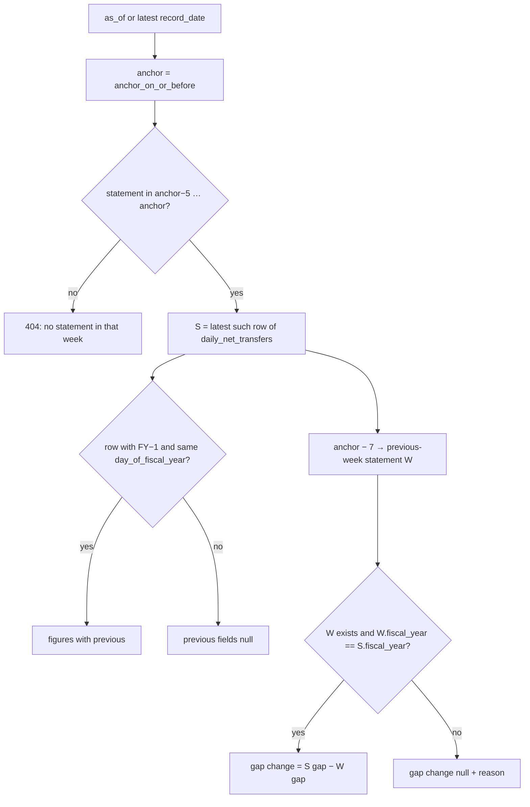

# Phase 3: Weekly snapshot — ✅ Done

**Goal**: A "Weekly snapshot" page that shows, for one week's statement, the figures a weekly
fiscal briefing leads with:
- withdrawals and net transfers month to date
- withdrawals, deposits, net transfers and withholding tax fiscal year to date, against the
  same business day a year earlier
- how much the net-transfers gap changed since last week

The week ends on a Thursday (the default, as in the newsletter) or a Friday. The existing
weekly comparison gets the same weekday choice.

Branch: `feat/weekly-snapshot`. Depends on Phase 1 (withholding uses category coverage).

## Scope

In scope:
- `GET /api/v1/snapshot/weekly`, the `/snapshot` page, and a nav item.
- `anchor_weekday` on `GET /api/v1/weekly/comparison`, and the weekday toggle on `/weekly`.
- Formula copy, the worked example (2025-12-04), and tests.

Out of scope:
- Rolling averages and combined figures on the snapshot (Phase 4).
- The cash balance on the snapshot (Phase 5).
- Weekdays other than Thursday and Friday.
- Saving the chosen weekday across visits.

## Implementation

### 1. Weekday helper — create `backend/app/utils/anchor.py`

```python
"""Week anchors: the weekday a weekly figure is read on."""

from datetime import date, timedelta
from typing import Literal

AnchorWeekday = Literal["thursday", "friday"]

# date.weekday(): Monday = 0.
WEEKDAY_NUMBER: dict[AnchorWeekday, int] = {"thursday": 3, "friday": 4}

# A holiday on the anchor day falls back to the closest earlier statement
# within this many days, the rule the weekly comparison has always used.
LOOK_BACK_DAYS = 5


def anchor_on_or_before(day: date, weekday: AnchorWeekday) -> date:
    """The latest ``weekday`` on or before ``day``."""
    return day - timedelta(days=(day.weekday() - WEEKDAY_NUMBER[weekday]) % 7)


def anchor_days(start: date, end: date, weekday: AnchorWeekday) -> list[date]:
    """Every ``weekday`` between ``start`` and ``end`` inclusive."""
```

`anchor_days` keeps the exact semantics of today's `_weekly_fridays`
(`backend/app/services/weekly.py:31`). It must accept `datetime` too (a subclass of `date`),
because `weekly.py` passes datetimes.

### 2. Weekly comparison — `backend/app/services/weekly.py`, `schemas/treasury.py`

- `WeeklyComparisonRequest` gains
  `anchor_weekday: AnchorWeekday = Field("friday", description="Weekday each week is read on")`.
- Delete `_weekly_fridays`. `get_comparison` calls
  `anchor_days(first_start, first_end, request.anchor_weekday)`, and the same for the second
  year.
- `_build_weekly_points` takes `max_days_back: int = LOOK_BACK_DAYS` (import it).
- Router docstring: "Net transfers FYTD on each week's anchor day (Friday by default) for two
  fiscal years."
- `backend/tests/test_formula_weekly.py`:
  - `test_fridays_between_two_dates` → `test_anchor_days_between_two_dates`, parametrized for
    `friday` (the existing expected list) and `thursday`.
  - Add `test_thursday_anchor_uses_thursdays`: seed Thursday and Friday statements and assert
    the Thursday dates come back.
  - Every existing test must still pass with the default.

### 3. Category helper — `backend/app/services/categories.py`

Extract the kind → source dispatch in `get_daily_yoy` (the if/elif on `cat_info.kind`) into:

```python
def _source_for(kind: CategoryKind) -> FYTDSource: ...


def category_fytd(cur: duckdb.DuckDBPyConnection, cat: CategoryDef, day: str) -> float | None:
    """Σ FYTD of ``cat``'s components on ``day``; ``None`` before ``available_from``."""
```

`get_daily_yoy` uses `_source_for`. `category_fytd` sums `fetch_component_fytd` over the
components and applies `covered` from Phase 1.

### 4. Schemas — `backend/app/schemas/treasury.py`

```python
class SnapshotFigure(BaseModel):
    """One FYTD figure against the same business day a year earlier."""

    current: float | None = Field(..., description="FYTD on the snapshot date")
    previous: float | None = Field(..., description="FYTD on the aligned previous-FY date")
    change: float | None = Field(..., description="current − previous")
    percent_change: float | None = Field(..., description="change ÷ |previous| × 100")


class WeeklySnapshotRequest(BaseModel):
    anchor_weekday: AnchorWeekday = Field("thursday", description="Weekday the week ends on")
    as_of: date | None = Field(None, description="Read the week on or before this date; default latest")


class WeeklySnapshotResponse(BaseModel):
    anchor_weekday: AnchorWeekday
    anchor_date: str = Field(..., description="The Thursday/Friday the week ends on")
    record_date: str = Field(..., description="Statement used; earlier than anchor_date after a holiday")
    fiscal_year: int
    day_of_fiscal_year: int
    previous_fiscal_year: int
    previous_date: str | None = Field(..., description="Same day_of_fiscal_year in the previous FY")
    withdrawals_mtd: float
    net_transfers_mtd: float
    withdrawals_fytd: SnapshotFigure
    deposits_fytd: SnapshotFigure
    net_transfers_fytd: SnapshotFigure
    withholding_fytd: SnapshotFigure
    previous_week_date: str | None = Field(..., description="Statement used for the week before")
    previous_week_net_transfers_gap: float | None
    net_transfers_gap_change: float | None = Field(..., description="This week's net-transfers change minus last week's")
    gap_change_unavailable_reason: str | None
```

`AnchorWeekday` is imported from `app.utils.anchor`.

### 5. Service — create `backend/app/services/snapshot.py`



Rules (each one a test in §7):
1. `latest = SELECT max(record_date) FROM daily_net_transfers WHERE record_date <= ?`, using
   `as_of`, or without the filter when `as_of` is `None`. If there is none, raise
   `HTTPException(404, "No statement on or before <as_of>")`.
2. `anchor = anchor_on_or_before(latest, weekday)`. When the latest statement is a Wednesday,
   the snapshot is last week's anchor. Only completed weeks are shown.
3. `record_date = max(record_date) WHERE record_date BETWEEN anchor − LOOK_BACK_DAYS AND anchor`.
   If there is none, raise `HTTPException(404, "No statement between <a> and <b>")`.
4. The previous-year row has `record_fiscal_year = S.fy − 1` and
   `day_of_fiscal_year = S.day_of_fiscal_year`. If it is missing (for example day 251 when
   FY−1 had 250 days), `previous_date` and every `previous`, `change` and `percent_change` is
   `None`.
5. Figures:
   - `withdrawals_fytd`: `total_withdrawals_fytd`
   - `deposits_fytd`: `total_deposits_fytd`
   - `net_transfers_fytd`: `net_flow_fytd`
   - `withholding_fytd`: `category_fytd(cur, CATEGORY_REGISTRY["Employment & Withholding Tax"], …)`
     on the two dates

   `change` and `percent_change` come from `nullable_yoy`. MTD figures are S's
   `total_withdrawals_mtd` and `net_flow_mtd`.
6. Previous week: apply rule 3 to `anchor − 7 days` to get `W`. If there is no `W`, the
   reason is `"No statement in the previous week"`. If W's fiscal year differs from S's, the
   reason is `"Last week was in FY<n>; a gap across October 1 compares different years"`.
   Otherwise compute W's net-transfers YoY change with rule 4. Then
   `net_transfers_gap_change = S change − W change`. If either change is `None`, the reason is
   `"No aligned previous-year statement"`.

All SQL goes through `cur.execute(sql, params)` on `daily_net_transfers`; no pandas.

### 6. Router — create `backend/app/api/routers/snapshot.py`; register it

```python
router = APIRouter(
    prefix="/api/v1/snapshot", tags=["snapshot"], dependencies=[Depends(cache_public)]
)


@router.get("/weekly", response_model=WeeklySnapshotResponse)
def get_weekly(
    cur: CursorDep, req: Annotated[WeeklySnapshotRequest, Query()]
) -> WeeklySnapshotResponse:
    """One week's statement: month and fiscal year to date, against a year earlier."""
    return snapshot.get_weekly(cur, req)
```

The operation id is `snapshot_get_weekly`. In `backend/app/main.py`, import `snapshot` and add
it to the `include_router` loop tuple (after `weekly`).

### 7. Backend tests

Add a row builder to `backend/tests/fixtures.py`. `insert_frame` fills missing columns with
NULL, so only the columns the snapshot reads are needed:

```python
def dnt_row(
    day: date,
    fy: int,
    day_of_fy: int,
    *,
    withdrawals_fytd: float,
    deposits_fytd: float,
    withdrawals_mtd: float = 0.0,
    net_mtd: float = 0.0,
    withdrawals_today: float = 0.0,
) -> pd.DataFrame:
    """One ``daily_net_transfers`` row; net FYTD = withdrawals − deposits."""
```

Create `backend/tests/test_formula_snapshot.py`. Use
`formula_db({"daily_net_transfers": [dnt_row(...)], "deposits_withdrawals": [catg_row(...)]})`.
`catg_row` provides the withholding line.
- `test_thursday_snapshot_pairs_the_same_fiscal_day`: the worked example with its real
  numbers:
  - 2025-12-04, FY2026, day 44: withdrawals FYTD 1,432,895, deposits FYTD 957,420,
    withdrawals MTD 200,188, net MTD 120,817
  - 2024-12-04, FY2025, day 44: 1,404,753 and 817,202
  - withholding 591,734 and 568,727

  Assert every `SnapshotFigure` against Phase 0's table.
- `test_a_holiday_anchor_uses_the_closest_earlier_statement`: seed Wed 2025-11-26 and no
  Thursday 2025-11-27. Assert `anchor_date == "2025-11-27"` and
  `record_date == "2025-11-26"`.
- `test_a_wednesday_latest_reads_last_weeks_thursday`.
- `test_friday_anchor`.
- `test_gap_change_widens`: −89,579 → −112,076 gives `net_transfers_gap_change == -22,497`.
- `test_gap_change_is_null_across_october_1`: Thursday 2025-10-02 with the previous week
  2025-09-25 gives `None` and the FY reason.
- `test_missing_previous_year_day_is_null`.
- `test_no_statement_is_404` (empty `formula_db`, `as_of` before data).

Create `backend/tests/test_snapshot_api.py`:
- `test_snapshot_route_answers(client)`: `anchor_weekday=friday`. The seed's latest is Friday
  2025-10-10. Assert 200, `record_date == "2025-10-10"` and `day_of_fiscal_year == 3`.
- `test_snapshot_thursday_has_no_statement_in_the_seed(client)`: `anchor_weekday=thursday`
  gives 404.
- `test_bad_anchor_is_422(client)`: `anchor_weekday=monday`.
- No change to `test_caching.py` is needed. `test_every_data_route_is_get_only` walks
  `app.openapi()`, so it covers the new route automatically.

### 8. Worked example

Add to **both** `frontend/src/features/methodology/worked-examples.json` and
`backend/app/mcp_server/worked-examples.json` (identical bytes) a key `weekly_snapshot`:

```json
"weekly_snapshot": {
  "anchor_weekday": "thursday",
  "record_date": "2025-12-04",
  "day_of_fiscal_year": 44,
  "previous_date": "2024-12-04",
  "withdrawals_fytd": {"current": 1432895, "previous": 1404753, "change": 28142, "percent_change": 2.0},
  "deposits_fytd": {"current": 957420, "previous": 817202, "change": 140218, "percent_change": 17.16},
  "net_transfers_fytd": {"current": 475475, "previous": 587551, "change": -112076, "percent_change": -19.08},
  "withholding_fytd": {"current": 591734, "previous": 568727, "change": 23007, "percent_change": 4.05},
  "withdrawals_mtd": 200188,
  "net_transfers_mtd": 120817,
  "previous_week": {
    "anchor_date": "2025-11-27",
    "record_date": "2025-11-26",
    "day_of_fiscal_year": 39,
    "previous_date": "2024-11-26",
    "withdrawals_fytd": {"current": 1219111, "previous": 1162688},
    "deposits_fytd": {"current": 855661, "previous": 709659},
    "gap": -89579
  },
  "gap_change": -22497
}
```

In `backend/tests/test_formula_examples.py` add `test_weekly_snapshot_example`. It builds a
`formula_db` from these numbers with `dnt_row` and `catg_row`, including the 2025-11-26 and
2024-11-26 rows (day 39) for the previous week, runs `snapshot.get_weekly(cur, WeeklySnapshotRequest(as_of=date(2025, 12, 4)))`
and asserts every field. Percent changes are rounded to 2 decimals before comparing.

### 9. Frontend

Create `frontend/src/components/anchor-weekday-select.tsx`. It is a `ToggleGroup`
(`@/components/ui/toggle-group`) with the items `Thursday` and `Friday`, a `Label` "Week ends
on", and props `{ value: AnchorWeekday; onChange(v: AnchorWeekday): void; id: string }`.
Export `type AnchorWeekday = 'thursday' | 'friday'`. Ignore an empty selection: a toggle group
can deselect, so keep the old value.

Create `frontend/src/features/snapshot/api.ts`:
- Export `type WeeklySnapshot = components['schemas']['WeeklySnapshotResponse']` and
  `SnapshotFigure`.
- `useWeeklySnapshot(anchor: AnchorWeekday, asOf: string | null)`: query key
  `['snapshot', 'weekly', anchor, asOf]`; `api.GET('/api/v1/snapshot/weekly', { params: { query: { anchor_weekday: anchor, ...(asOf ? { as_of: asOf } : {}) } } })`;
  error message `'Could not load the weekly snapshot'`.

Create `frontend/src/features/snapshot/lib.ts` (pure, with `lib.test.ts`):

```ts
export type GapChange = {
  kind: 'widened' | 'narrowed' | 'flipped' | 'unchanged'
  amount: number // |current − previous|
}

/** How the year-over-year gap moved since last week. */
export function describeGapChange(previousGap: number | null, currentGap: number | null): GapChange | null

/** "Thursday, Dec 4, 2025"; also the holiday note when record_date ≠ anchor_date. */
export function snapshotHeading(s: WeeklySnapshot): { title: string; holidayNote: string | null }
```

The `describeGapChange` rules:
- `null` in → `null`.
- The signs differ (and neither is 0) → `flipped`.
- |current| > |previous| → `widened`.
- |current| < |previous| → `narrowed`.
- Otherwise → `unchanged`.

Tests:
- −89,579 → −112,076 is widened by 22,497.
- −136,062 → −100,199 is narrowed by 35,863. These are the real Dec 11 and Dec 18, 2025
  gaps; the newsletter called it "an improvement of $36 bln".
- 10 → −5 is flipped.
- `null` → `null`.
- The holiday note appears for 2025-11-27 / 2025-11-26.

Create `frontend/src/features/snapshot/components/figure-card.tsx`:
`FigureCard({ title, figure, previousFiscalYear, hint })`.
- It renders `formatBillions(figure.current)`, or `'—'` for `null`.
- The note line reads "vs <formatBillions(previous)> in FY<n> · <signed change> (<signed %>)".
  It reuses `changeClass` and `signedPrefix` from `@/features/yoy/components/accent`.
- It is built from `Card` like `StatCard`, so it looks the same.

Create `frontend/src/features/snapshot/components/snapshot-header.tsx`: a `Card` that shows
- the `snapshotHeading` title
- "FY<fy>, day <n> · compared with <previous_date> (FY<n−1>, day <n>)"
- the holiday note, when there is one

Create `frontend/src/features/snapshot/snapshot-page.tsx`, top to bottom:
1. A controls `Card`: `AnchorWeekdaySelect` (state default `'thursday'`), and a native
   `<Input type='date' id='as-of'>` labelled "As of" with a "Latest" `Button`
   (`variant='outline'`) that clears it. When empty, `asOf = null`.
2. `QueryState` on `useWeeklySnapshot`:
   - `SnapshotHeader`
   - section "This month so far": `StatCard`s "Withdrawals, month to date"
     (`hint='today-mtd-fytd'`) and "Net transfers, month to date" (`hint='net-transfers'`),
     in a `grid gap-4 sm:grid-cols-2`
   - section "Fiscal year to date, against a year ago": `FigureCard`s "Total withdrawals"
     (`total-withdrawals`), "Total deposits" (`total-deposits`), "Net transfers"
     (`net-transfers`) and "Withholding tax" (`major-receipts`), in a
     `grid gap-4 sm:grid-cols-2 xl:grid-cols-4`
   - section "Net transfers gap": a `StatCard` "Gap vs a year ago" with the value
     `net_transfers_fytd.change`. Its note is built from `describeGapChange`, for example
     "Widened by $22.5B since Wed, Nov 26". When the change is `null`, show
     `gap_change_unavailable_reason`. Use `hint='weekly-snapshot'`.

Section headings use `<h2 className='text-sm font-medium text-muted-foreground'>`, matching
the existing pages.

Create `frontend/src/routes/snapshot.tsx` with `createFileRoute('/snapshot')` and
`<Page title='Weekly snapshot'><SnapshotPage /></Page>`.

`frontend/src/components/layout/data/sidebar-data.ts`: add
`{ title: 'Weekly snapshot', url: '/snapshot', icon: Newspaper }` right after Overview (import
`Newspaper` from `lucide-react`).

Weekly page:
- `frontend/src/features/weekly/api.ts`: `useWeeklyComparison(first, second, anchor)`. Add
  `anchor` to the query key and pass `anchor_weekday`.
- `weekly-page.tsx`: add `AnchorWeekdaySelect` (default `'friday'`) to the controls card.
- Change the description to "Net government transfers on each week's anchor day, or the
  closest earlier day with data".

### 10. Formula copy

`frontend/src/features/methodology/formulas.ts`:
- Add `'weekly-snapshot'` to `FormulaId`, and add it after `'weekly-comparison'` in
  `FORMULA_ORDER`.
- The entry:
  - title `'Weekly snapshot'`
  - summary `'One week’s statement against the same business day a year earlier, and how the net-transfers gap moved since the week before.'`
  - expression:
    - `'Snapshot date = latest statement on or up to 5 days before the anchor weekday'`
    - `'Change = FYTD(snapshot) − FYTD(same day of the previous fiscal year)'`
    - `'Gap change = this week’s net-transfers change − last week’s'`
  - pitfalls:
    - `'The gap change is blank in the first week of a fiscal year: last week belongs to another pair of years.'`
    - `'After a holiday the snapshot uses the closest earlier statement, so its month-to-date covers one day less.'`
  - `source: DEPOSITS_TABLE`
- Update `'weekly-comparison'`'s expression to say "each week's anchor day (Friday by
  default, or Thursday)" instead of "each Friday".

`methodology-page.tsx`, section `friday-snapshots`:
- Retitle it `'12. Weekly comparison and snapshot'`, and update the TOC entry's `title` to
  match. **Keep the id** `friday-snapshots`, because links point at it.
- Add a paragraph with the worked example from `examples.weekly_snapshot`:
  "On Thursday, Dec 4, 2025 (day 44) net transfers were 475,475 against 587,551 a year
  earlier, a change of −112,076. A week earlier Thursday was Thanksgiving, so the snapshot
  read Wednesday, Nov 26: −89,579. The gap widened by 22,497."
  Render the numbers from the JSON, not literals, the same way the section reads `NT`.
- Then `<FormulaBlock id='weekly-snapshot' />`.

### 11. Contract and routes

```bash
cd backend && uv run python -m scripts.export_openapi
cd ../frontend && pnpm gen:api && pnpm build   # build regenerates src/routeTree.gen.ts
```

Commit `routeTree.gen.ts` with the route.

## Verification

- [ ] `cd backend && uv run pytest` green: the new `test_formula_snapshot.py` (8 tests),
      `test_snapshot_api.py` (3), the updated weekly tests and `test_weekly_snapshot_example`.
- [ ] `uv run ruff check . && uv run ruff format --check .` clean.
- [ ] `diff frontend/src/features/methodology/worked-examples.json backend/app/mcp_server/worked-examples.json`
      prints nothing.
- [ ] `cd frontend && pnpm typecheck && pnpm test && pnpm build` green.
- [ ] Against the real artifact:
      `curl -s 'localhost:8000/api/v1/snapshot/weekly?as_of=2025-12-04' | jq '{record_date, day_of_fiscal_year, n: .net_transfers_fytd, g: .net_transfers_gap_change}'`
      → `"2025-12-04"`, `44`, change `-112076`, gap change `-22497`.
- [ ] `curl -s 'localhost:8000/api/v1/snapshot/weekly?as_of=2025-11-28' | jq .record_date`
      → `"2025-11-26"`.
- [ ] `curl -s 'localhost:8000/api/v1/snapshot/weekly?as_of=2025-10-02' | jq .gap_change_unavailable_reason`
      → the October 1 reason.
- [ ] `/snapshot` shows the "Week ending Thursday, …" header, 2 month-to-date cards, 4
      fiscal-year cards and the gap card. Switching to Friday and setting "As of" to
      2025-12-05 shows the Dec 5 statement.
- [ ] `/weekly` with "Thursday" shows Thursday dates in the table. With "Friday" the result
      equals today's page.
- [ ] MCP `list_api("snapshot")` lists `snapshot_get_weekly`.

## Notes

- The snapshot reads `daily_net_transfers` only, plus one category sum. It needs no new
  ingestion.
- `as_of` makes any past issue of the newsletter checkable: `as_of=<the issue's Thursday>`.

## Implementation notes

Landed on `feat/weekly-snapshot` (4a2d32c), stacked on Phase 2.
- **Holiday test.** It needs a statement after the holiday. Rule 2 anchors on the latest statement, so with only Wed 2025-11-26 the snapshot reads the week before. The real data has Fri 2025-11-28, and `as_of=2025-11-28` gives `record_date` 2025-11-26 as planned. Consequence: `as_of` set to a holiday Thursday itself, or "latest" before the next statement is out, still shows the previous week.
- **Seed check.** `test_snapshot_thursday_has_no_statement_in_the_seed` is a 404, as planned.
- **Route tree.** `pnpm build` runs `tsc` before Vite regenerates `routeTree.gen.ts`, so a new route needs `pnpm exec vite build` once first.
