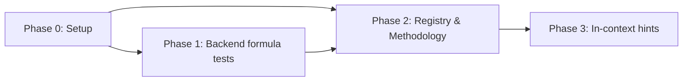

# Formula Education — Tests and Explanations for Every Formula

DTS Analysis is an educational app: a visitor should be able to see a number, ask "how was this
calculated?", and get a plain answer with a worked example from a real Treasury statement. This
plan (1) pins every financial formula with backend unit tests, (2) puts each formula's definition
in one typed registry with real worked examples that the backend tests also check, and (3) turns
the Methodology page into a full explainer and adds a "How is this calculated?" hint next to
every computed figure in the app.

Source material: `../dts-analysis/docs/fullstack/02-terminologies.md` and
`03-calculations.md`, checked against this repo's code (the reference docs have drifted in
places — the code wins).

## Status

| Phase | Status | Description |
|-------|--------|-------------|
| Phase 0: Setup | ✅ Done | Formula inventory, decisions, worked examples, file list |
| Phase 1: Backend formula tests | ⬜ Not Started | Unit tests for every formula in `app/utils` + `app/services`; worked-examples JSON checked against the real code |
| Phase 2: Formula registry & Methodology | ⬜ Not Started | `formulas.ts` registry, `FormulaBlock`, a long-form educational Methodology page with anchors |
| Phase 3: In-context explanations | ⬜ Not Started | `FormulaHint` popover next to every computed figure, linking to its Methodology section |

## Phase Dependencies

Phase 2 needs Phase 1's `worked-examples.json` and its passing test; Phase 3 needs Phase 2's
registry and Methodology anchors.

## Key Decisions

- **One registry, two readers.** Each formula's name, one-line summary, expression and pitfalls
  live once in `frontend/src/features/methodology/formulas.ts`. The Methodology page and every
  in-context hint render from it, so the two can never disagree.
- **Worked examples are real and tested.** Numbers come from the 2026-10-19 statement (FY2027
  day 12) and FY2026 day 12 (2025-10-17). They live in
  `frontend/src/features/methodology/worked-examples.json`; a backend test feeds the raw inputs
  through the real formula functions and asserts the outputs, so copy and code can't drift.
- **Unit tests target the formula functions, not HTTP.** Phase 3 of the launch plan already
  covers the API; this plan tests `calculate_daily_net_transfers`, `yoy_change`, the alignment
  helpers, the category sums, and the weekly Friday rule directly, including every fallback branch.
- **Pin current behavior, document it, don't change it.** Where the code does something
  surprising (calendar-date category cards fall back to the latest earlier statement; percent
  change divides by |previous|), the tests pin it and the Methodology page explains it. Behavior
  changes are out of scope.
- **Popover, not tooltip, for hints** — works on touch screens, can hold a link, and is
  keyboard reachable (shadcn `Popover`, already in `components/ui/popover.tsx`).

## How to Resume

1. Read this README for current status.
2. Read `phase-0-setup.md` — the formula inventory and the worked examples.
3. Open the first phase that is not ✅ Done.
