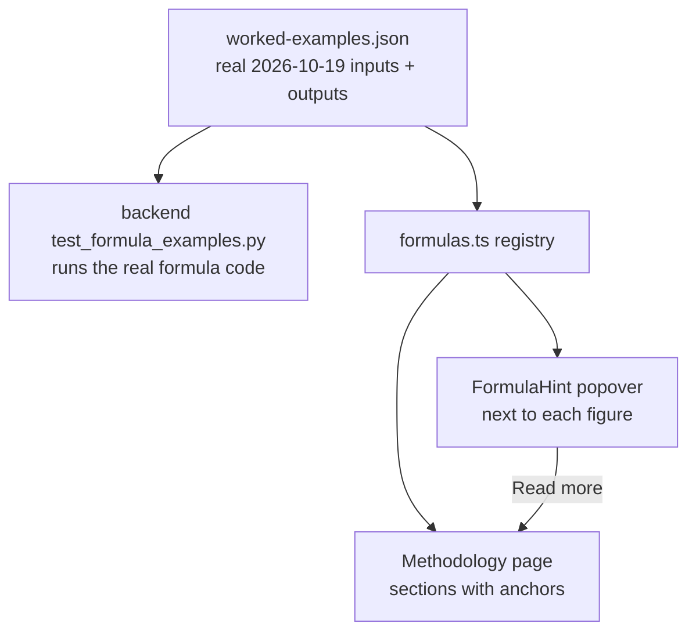

# Phase 0: Setup — ✅ Done

**Goal**: Fix the formula inventory, the worked examples, the decisions, and the file list that
Phases 1–3 build on.

## Existing State

### Formula code (backend) — no direct unit tests today

| Formula | Code | Tested today |
|---|---|---|
| Total deposits / withdrawals / net transfers (today, MTD, FYTD), leading flow | `backend/app/utils/deposits_withdrawals.py:16` `calculate_daily_net_transfers` | Only indirectly via `tests/test_net_transfers_api.py` and `tests/test_ingest_populate.py` |
| Fallbacks: pre-aggregated totals → sum of TGA rows → sum of `Federal Reserve Account` rows (pre-2015 history) → `None`; debt rows missing → 0; debt rows from `Federal Reserve Account` | same file, lines ~45–200 | No |
| Day of fiscal year = rank among **all** statement dates in the FY (days without totals keep their number but get no row) | `backend/app/ingest/populate.py:41` `compute_daily_records` | Indirectly |
| Day of FY in category queries = `DENSE_RANK() OVER (ORDER BY record_date)` | `backend/app/services/yoy.py:78` | No |
| YoY delta and percent: `delta = current − previous`; `pct = delta / |previous| × 100`, `None` when previous = 0 | `backend/app/utils/yoy.py:255` `yoy_change` | No |
| Day-N lookup / reverse lookup | `backend/app/utils/yoy.py:92` `fiscal_day_for_date`, `:113` `date_for_fiscal_day` | No |
| Previous-year date for category cards: `fiscal_day` → same Day N, else latest of previous FY; `calendar_date` → same MM-DD, else latest ≤ that date, else latest of previous FY | `backend/app/utils/yoy.py:139` `find_aligned_previous_date` | No |
| Component FYTD read (honors `transaction_type` filter) / per-day sum | `backend/app/utils/yoy.py:200` `fetch_component_fytd`, `:224` `fetch_components_daily` | No |
| Daily YoY series: `fiscal_day` pairs Day N up to min(max days); `calendar_date` keeps only MM-DD present in both years | `backend/app/services/yoy.py:186` `get_daily_comparison` (pairing ~line 290–380) | Via API only |
| Category groups (4 spending, 2 receipt) and component lists | `backend/app/constants/categories.py:38`, `:71` | No |
| T-Bill interest = `Bills (-)` + `Bonds and Notes (-)` (`adjustment_public_debt.adj_fytd_amt`) | `categories.py:92`, `backend/app/services/categories.py:284` | Via API only |
| IRS refunds = 4 `tax_refund_type`s from `income_tax_refunds` (Table V, not Table II) | `categories.py:105`, `services/categories.py:352` | Via API only |
| Category daily YoY | `services/categories.py:427` `get_daily_yoy` | Via API only |
| Weekly: Fridays of each FY (clipped to today), each Friday or up to 5 days earlier, second year truncated to first year's week count, same FY twice → `ValueError` | `backend/app/services/weekly.py:23,31,45,83` | Via API only |
| Fiscal year bounds / current FY | `backend/app/utils/fiscal.py` | Yes, `tests/test_fiscal.py` |

Test conventions: flat `backend/tests/test_*.py`, plain `def test_…` functions, row builders in
`backend/tests/fixtures.py` (`dw_day`, `dw_day_without_totals`, `endpoint_row`), seeded artifact
via `create_schema` + `insert_frame` + `populate_fiscal_years` in `backend/tests/conftest.py`.

### Formula code (frontend) — already unit tested

`frontend/src/features/yoy/lib.ts` (`summarize`, `spendingCards`, `receiptCards`,
`breakdownRows`, `categoryDiffSeries`, `comparisonRows`), `features/weekly/lib.ts` (`weekRows`,
`computeSummaryStats`), `features/daily/lib.ts` (`flowDirection`, `formulaSteps`), `lib/format.ts`
— each has a `lib.test.ts`. Phase 2 adds tests only for the new registry.

### Explanations in the UI today (scattered)

- Single date: "How are these numbers calculated?" toggle —
  `frontend/src/features/daily/components/net-transfers-summary.tsx:98`.
- Withdrawals YoY: one info alert — `frontend/src/features/yoy/withdrawals-page.tsx:12`.
- Category comparison: collapsible card — `frontend/src/features/yoy/components/methodology-card.tsx`.
- Methodology page: 7 short sections — `frontend/src/features/methodology/methodology-page.tsx`
  using `ProseSection` (`frontend/src/components/prose-section.tsx`).
- Hint building blocks available: `components/ui/popover.tsx`, `components/stat-card.tsx`
  (`title`, `value`, `note`).

### Prior plans

`docs/plans/dts-webapp/` (launch plan). Its Phase 7 wrote the short Methodology page; this plan
replaces that page's body and leaves the route, `Terms` and `Privacy` untouched.

## Architecture

## Worked examples (verified against the 2026-10-19 artifact)

All amounts are millions of dollars.

**Net transfers, 2026-10-19 (FY2027, day 12)**

| | Today | FYTD |
|---|---|---|
| TGA total deposits | 32,776 | 1,949,405 |
| − Public debt cash issues | 1,023 | 1,659,685 |
| = Total deposits | 31,753 | 289,720 |
| TGA total withdrawals | 16,223 | 1,968,406 |
| − Public debt cash redemptions | 1,225 | 1,569,754 |
| = Total withdrawals | 14,998 | 398,652 |
| **Net transfers** = withdrawals − deposits | **−16,755** (net inflow) | **108,932** |

**Year over year, fiscal-day mode, day 12:** FY2027 net transfers FYTD 108,932 vs FY2026 day 12
(2025-10-17) 94,000 → difference **+14,932**, percent change 14,932 / |94,000| × 100 = **+15.89 %**.
In calendar-date mode the same day pairs with 2025-10-19, a Sunday with no statement: the daily
chart drops the date; the category cards use the latest earlier statement (2025-10-17).

**Percent change with a negative previous value** (illustrative, not data): previous −50,
current −30 → difference +20; ÷ |−50| → **+40 %** (it improved). Dividing by −50 would print −40 %.

**Categories, FYTD on 2026-10-19 vs 2025-10-17**

| Category | Components | FY2027 | FY2026 | Change |
|---|---|---|---|---|
| Medicare | Hospital Insr 28,951 + Supple Med Insr 42,077 + Prescription Drugs 10,505 | 81,533 | 26,849 + 38,413 + 6,969 = 72,231 | +9,302 (+12.88 %) |
| Customs & Duties | "DHS - Customs Duties, Taxes, and Fees" 3,870 (name used from 2025-11-10) | 3,870 | "DHS - Customs and Certain Excise Taxes" 4,715 (name used until 2025-11-07) | −845 (−17.92 %) |
| T-Bill interest | Bills (−) 17,006 + Bonds and Notes (−) 3,745 | 20,751 | 13,738 + 127 = 13,865 | +6,886 (+49.66 %) |
| IRS tax refunds (Table V) | Individual EFT 4,394 + Individual checks 1,788 + Business EFT 827 + Business checks 3,549 | 10,558 | — | — |

IRS refund undercount: Table II (`deposits_withdrawals`) carries only the two EFT lines, 4,394 +
827 = 5,221 — half of the Table V total.

**Social Security FYTD fell 26 %** (69,492 vs 94,379) at day 12. Before using it anywhere as an
example, Phase 2 must confirm the cause from `transaction_today_amt` by date (expected: benefit
payment Wednesdays fall on Oct 8 and 15 in 2025 but only Oct 14 by day 12 in 2026). If
confirmed, the Methodology "Known limits" section uses it to explain that fiscal-day alignment
does not align payment calendars.

## Files by phase

**Phase 1** — create `backend/tests/test_formula_net_transfers.py`,
`test_formula_yoy.py`, `test_formula_categories.py`, `test_formula_weekly.py`,
`test_formula_day_of_fiscal_year.py`, `test_formula_examples.py`; modify `backend/tests/fixtures.py`
(new row builders + `formula_db` helper); create
`frontend/src/features/methodology/worked-examples.json`.

**Phase 2** — create `frontend/src/features/methodology/formulas.ts`, `formulas.test.ts`,
`components/formula-block.tsx`, `components/methodology-toc.tsx`; rewrite
`frontend/src/features/methodology/methodology-page.tsx`; modify `CLAUDE.md` (the examples
contract); delete `frontend/src/features/yoy/components/methodology-card.tsx` and its use in
`category-comparison-page.tsx` (replaced by hints + link).

**Phase 3** — create `frontend/src/components/formula-hint.tsx`; modify `components/stat-card.tsx`
(optional `hint` prop), `features/daily/components/net-transfers-summary.tsx`,
`features/daily/components/fiscal-year-table.tsx`, `features/yoy/yoy-analysis-layout.tsx`,
`features/yoy/withdrawals-page.tsx`, `features/yoy/deposits-page.tsx`,
`features/yoy/net-transfers-page.tsx`, `features/yoy/components/category-card.tsx`,
`features/yoy/components/category-detail-dialog.tsx`, `features/yoy/category-comparison-page.tsx`,
`features/weekly/components/summary-stats.tsx`, `components/charts/chart-controls.tsx`,
`features/overview/overview-page.tsx`.

## Constraints

- No change to any formula's behavior, API response, or `docs/contracts/openapi.json`.
- Copy follows `CLAUDE.md`: plain words, no metaphors, define an acronym before using it.
- Amounts in copy are millions of dollars, formatted with `lib/format.ts` when rendered.
- Every figure in copy must come from `worked-examples.json` or from code constants — never
  typed by hand into JSX.
