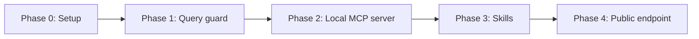

# MCP Server — Let an Agent Query the Treasury Data

Adds a FastMCP server so an agent like Claude can work with the DTS data directly. It can
discover and call the app's own API, run read-only SQL against the DuckDB artifact, and read
methodology "skills" (Markdown files) that explain how the numbers are computed. The server
runs **locally over stdio first**. Every limit is designed so the same server can later be
mounted publicly at `/api/mcp` on Vercel without changing the tool code.

## Status

| Phase | Status | Description |
|-------|--------|-------------|
| Phase 0: Setup | ✅ Done | Existing state, architecture, tool contracts, decisions, file inventory |
| Phase 1: Query guard | ✅ Done | Lock down the shared DuckDB connection; `run_select` service with single-SELECT check, row cap, timeout, concurrency slots |
| Phase 2: Local MCP server | ✅ Done | `app/mcp_server/` with `list_api`, `describe_api`, `call_api`, `run_query`; stdio entrypoint; `.mcp.json` for Claude Code |
| Phase 3: Skills | ⬜ Not Started | `get_skills` tool, Markdown skills folder with placeholders rendered from live schema, category registry and worked examples; drift tests |
| Phase 4: Public endpoint | ⬜ Not Started | Mount stateless streamable HTTP at `/api/mcp` in the FastAPI app, verify on a Vercel preview, document operations |

## Phase Dependencies

This is a strict chain. Phase 4 is deliberately last and optional: Phases 1–3 deliver a working
local server, and Phase 4 starts only when the owner decides to go public.

## Key Decisions

- **Five generic tools, not one tool per route.** `list_api`, `describe_api`, `call_api`,
  `run_query`, `get_skills`. FastMCP's `from_fastapi` would generate 21 tools, and its docs
  advise against mirroring a REST API. The generic set stays small and follows the API
  automatically because it reads `app.openapi()` at runtime.
- **`search_api` is folded into `list_api(query=...)`.** With 21 operations, a substring filter
  over id, path and summary does the job. A ranked search tool can come later if the API grows.
- **`call_api` calls the FastAPI app in-process** through `httpx.ASGITransport`. Requests get
  the same validation and error mapping the frontend gets, with no network hop and no base URL
  to configure. Only `GET /api/v1/*` operations are callable.
- **The lockdown goes on the one shared connection.** DuckDB refuses a second connection to the
  same file with a different config (verified on 1.5.6), so `run_query` cannot have its own
  stricter connection. The serving app never reads files or the network, so
  `enable_external_access=false` + `lock_configuration=true` cost it nothing.
- **The lockdown is applied with `SET` after `connect`.** Passing `enable_external_access` in
  the `connect` config makes DuckDB reject the `temp_directory` setting (verified on 1.5.6).
- **Only one `SELECT` statement per query**, checked with `duckdb.extract_statements`.
  `DESCRIBE`, `SHOW`, `SUMMARIZE`, `FROM t` and `VALUES` parse as `SELECT` and are allowed.
  `PIVOT` parses as `CREATE` + `SELECT` and is rejected.
- **Limits fail loudly.** A result over the row cap comes back with `truncated: true`. A result
  over the byte cap, a timeout, or busy query slots raise a `ToolError` that says how to narrow
  the query. Nothing is silently cut (the repo's "no silent fallbacks" rule).
- **Skills render placeholders from the code, not hand-copied facts.** `{{schema}}` comes from
  the live `information_schema`, `{{categories}}` from `CATEGORY_REGISTRY`, and
  `{{example:<path>}}` from a backend copy of `worked-examples.json`. Tests guard the copy and
  every SQL block in the skills.
- **The package is `app/mcp_server/`, not `app/mcp/`**, so it can never be confused with the
  `mcp` SDK package that FastMCP depends on.
- **Public mode stays unauthenticated.** The data is public domain. Abuse is handled by the
  query limits plus the existing Vercel WAF rule `api-per-ip`, which already matches `/api/`.

## How to Resume

1. Read this README for current status.
2. Read `phase-0-setup.md` for the architecture, the tool contracts and the file inventory.
3. Open the current 🔄 In Progress or 🔁 Rework phase file. If none, open the first ⬜ Not Started.
4. The explainer page (`explainer.html`) is the human briefing. Keep it in sync with key decisions.
