# Phase 0: Setup — ✅ Done

**Goal**: Fix the architecture, tool contracts, limits and file inventory every later phase builds on.

## Existing State

Findings from the codebase (2026-10-24, `main` at `54df43b`):

### Reused as-is

- **One read-only DuckDB connection per process.** `backend/app/core/duckdb.py:20`
  `get_connection()` (`lru_cache`) opens the artifact with `read_only=True` and
  `config={"temp_directory": "/tmp/duckdb"}` (line 25). Its docstring (line 5) says no other
  module may call `duckdb.connect`. `run_query` uses this connection; it does not open its own.
- **Cursor per request.** `backend/app/api/deps.py:12` `get_cursor()` yields
  `get_connection().cursor()` and closes it. MCP tools follow the same pattern by hand
  (there is no FastAPI dependency injection inside an MCP tool).
- **The OpenAPI spec.** `backend/app/main.py:22` `generate_unique_id` makes operation ids
  `"{tag}_{route.name}"`. `app.openapi()` is what `scripts/export_openapi.py` writes to
  `docs/contracts/openapi.json`. It has 21 operations: 20 `GET /api/v1/*` and `GET /api/health`.
  Three take path parameters: `/api/v1/data/date/{date}`, `/api/v1/net-transfers/date/{date}`,
  `/api/v1/net-transfers/fiscal-year/{fiscal_year}`.
- **Error mapping.** `backend/app/main.py:45` maps `DataUnavailable` → 503 and line 50 maps
  `ValueError` → 400 with `{"detail": str(exc)}`. New service errors subclass `ValueError`
  so the same mapping works if they ever reach HTTP.
- **Settings.** `backend/app/core/config.py` `Settings` (env prefix `APP_`, `get_settings()`
  `lru_cache`). New limits are added here.
- **Table registry.** `backend/app/constants/endpoints.py` `ALL_TABLES` (9 endpoint tables +
  `daily_net_transfers`), plus the `metadata` table from `backend/app/core/schema.py`.
- **Category registry.** `backend/app/constants/categories.py:122` `CATEGORY_REGISTRY:
  dict[str, CategoryDef]` (`name`, `kind`, `components`). The categories skill renders from it.
- **Formula registry (frontend).** `frontend/src/features/methodology/formulas.ts:6–23`
  `FormulaId` lists 17 ids (`net-transfers`, `yoy-percent`, `day-of-fiscal-year`, …). Skills
  reference these ids in frontmatter, and a test checks that each id still exists.
- **Worked examples.** `frontend/src/features/methodology/worked-examples.json`, checked against
  the real formula code by `backend/tests/test_formula_examples.py` (path built at line 31).
- **Test fixtures.** `backend/tests/conftest.py` builds a seeded artifact with the real schema
  code. `_client_for` (line 78) sets `APP_DUCKDB_PATH`, clears `get_settings`, and calls
  `reset_connection_for_tests()`. The MCP fixture copies this pattern.
- **Rate limiting.** `docs/plans/dts-webapp/phase-7-launch-hygiene.md:34`: the Vercel WAF rule
  `api-per-ip` matches every path starting with `/api/`, so it already covers `/api/mcp`.
- **Vercel function.** `vercel.json` `services.api.functions["app/main.py"]`:
  `maxDuration: 30`, and `excludeFiles` drops `tests/**` and `scripts/**`. Anything the MCP
  server reads at runtime must live under `backend/app/` (or `backend/data/`), never `scripts/`.

### Absent (this plan creates it)

- No MCP code, no `fastmcp` dependency, no `.mcp.json`, no arbitrary-SQL path anywhere.
- No async tests yet. `pytest-asyncio` is not installed. `httpx` is only a dev dependency
  (it does come in transitively through `fastapi[standard]`).

### DuckDB behaviour verified on 1.5.6 (the locked version)

| Probe | Result |
|---|---|
| `connect(..., config={"temp_directory": ..., "enable_external_access": False})` | **Fails**: `PermissionException: Modifying the temp_directory has been disabled` |
| `connect(..., config={"temp_directory": ...})` then `SET enable_external_access = false`, `SET lock_configuration = true` | Works; `temp_directory` keeps its value |
| After lockdown: `read_csv('/etc/passwd')`, `COPY t TO '...'`, `INSTALL httpfs` | `PermissionException` |
| After lockdown: `SET enable_external_access = true` | `InvalidInputException` (configuration locked) |
| After lockdown: `ATTACH ':memory:'` | `CatalogException` (read-only) |
| Second `duckdb.connect(same_file, read_only=True)` with a different config | `ConnectionException: ... different configuration` |
| `cursor.interrupt()` from a `threading.Timer` | Long query raises `duckdb.InterruptException` |
| `extract_statements` types | `DESCRIBE`, `SHOW`, `SUMMARIZE`, `FROM t`, `VALUES`, `PRAGMA version` → `SELECT`; `EXPLAIN` → `EXPLAIN`; `CALL` → `CALL`; `PIVOT ...` → `CREATE`, `SELECT` |
| `SELECT * FROM (<q with ORDER BY>) q LIMIT n` | Keeps the inner order |

### Conventions in force

- Layering: routers → `app/services` (all query logic) → DuckDB. `run_select` is a service; the
  MCP tools are a thin transport layer, like routers.
- `python-style` and `fastapi` skills for all backend code. Google docstrings, type hints,
  Ruff (88 columns). Run `uv run ruff check . && uv run ruff format .` before finishing.
- uv only (`uv add`), never pip.
- No silent fallbacks: unknown names raise; limits raise with a message the agent can act on.
- Comments explain *why*, at the density of the surrounding code.
- Branch per phase: `feat/query-guard`, `feat/mcp-server`, `feat/mcp-skills`, `feat/mcp-public`.

### Overlapping plans

- `docs/plans/dts-webapp/` (Phase 7 🟡 In Progress): this plan relies on its rate-limit rule
  and Sentry setup but changes nothing in it.
- `docs/plans/formula-education/` (all ✅ Done): owns `formulas.ts` and `worked-examples.json`.
  This plan reads them and adds no formulas. If a formula changes, that plan's rule still holds
  ("change a formula and both must be updated"), and Phase 3 adds a third file to keep in step:
  the backend copy of `worked-examples.json`.

## Architecture

```mermaid
flowchart TD
    A[Agent: Claude Code / Claude Desktop] -->|stdio, Phases 2-3| S
    A -.->|streamable HTTP /api/mcp, Phase 4| S
    S[app/mcp_server/server.py<br/>build_server] --> T1[list_api / describe_api]
    S --> T2[call_api]
    S --> T3[run_query]
    S --> T4[get_skills]
    T1 --> O[app.openapi&#40;&#41;]
    T2 -->|httpx.ASGITransport| F[FastAPI app: routers → services]
    T3 --> Q[app/services/sql.py run_select]
    T4 --> K[app/mcp_server/skills/*.md]
    K -->|placeholders| Q
    F --> C[(get_connection&#40;&#41;<br/>read-only, locked)]
    Q --> C
```

`build_server(api: FastAPI) -> FastMCP` takes the FastAPI app as an argument, so the stdio
entrypoint (`app/mcp_server/__main__.py`) and the Phase 4 mount (`app/main.py`) build the same
server with no circular import.

## Tool Contracts

All tools are annotated `readOnlyHint=True`, and raise
`fastmcp.exceptions.ToolError` with an actionable message on any failure.

| Tool | Arguments | Returns |
|---|---|---|
| `list_api` | `query: str \| None = None` | `list[OperationSummary]`: `operation_id`, `method`, `path`, `tag`, `summary`. Only `GET` operations under `/api/v1/`. `query` filters case-insensitively on `operation_id`, `path` and `summary`. |
| `describe_api` | `operation_id: str` | `OperationDetail`: summary fields + `description`, `parameters` (`name`, `location` = `path`\|`query`, `required`, `schema`, `description`), `response_schema` with every `$ref` it reaches inlined under `components`. Unknown id → `ToolError` naming `list_api`. |
| `call_api` | `operation_id: str`, `params: dict[str, Any] \| None = None` | `ApiCallResult`: `status`, `path` (the resolved URL path + query string), `body` (parsed JSON). Unknown param name, missing required param, non-2xx status, or a body over `mcp_max_response_bytes` → `ToolError`. |
| `run_query` | `sql: str`, `max_rows: int = 200` | `QueryResult`: `columns` (`name`, `type`), `rows` (`list[list[Any]]`), `row_count`, `truncated`, `elapsed_ms`. |
| `get_skills` | `name: str \| None = None` | No name → `list[SkillSummary]` (`name`, `description`). With a name → `Skill` (`name`, `description`, `formulas`, `body` rendered). Unknown name → `ToolError` listing the names. |

## Limits (new `Settings` fields, env prefix `APP_`)

| Field | Default | Applies to | Why this value |
|---|---|---|---|
| `duckdb_memory_limit` | `"1GB"` | the shared connection | Half of a 2 GB Vercel function, leaving room for Python + pandas |
| `query_default_rows` | `200` | `run_query` default `max_rows` | Enough for a fiscal year of daily rows (~250 business days) after aggregation |
| `query_max_rows` | `2000` | `run_query` upper bound for `max_rows` | Keeps a result well under the byte cap |
| `query_timeout_seconds` | `10.0` | `run_select` | A third of `maxDuration: 30` |
| `query_concurrency` | `2` | `run_select` slots per process | One heavy query can't starve the API on a shared function |
| `mcp_max_response_bytes` | `262144` | `run_query`, `call_api` | 256 KiB of JSON is about 60k tokens; more is useless to an agent |

## File Inventory

### Phase 1: Query guard
- Modify `backend/app/core/config.py`: add the six fields above.
- Modify `backend/app/core/duckdb.py`: apply `memory_limit` in config, then the lockdown `SET`s.
- Create `backend/app/schemas/sql.py`: `ColumnInfo`, `QueryResult`.
- Create `backend/app/services/sql.py`: `QueryRejected`, `QueryTimeout`, `QueryBusy`, `run_select`.
- Create `backend/tests/test_sql_guard.py`.

### Phase 2: Local MCP server
- `backend/pyproject.toml` + `backend/uv.lock`: `uv add "fastmcp>=4.1.3,<5" httpx`, `uv add --dev pytest-asyncio`; `asyncio_mode = "auto"`.
- Create `backend/app/mcp_server/__init__.py`, `__main__.py`, `server.py`, `openapi_catalog.py`, `models.py`.
- Create `backend/tests/test_mcp_catalog.py`, `backend/tests/test_mcp_tools.py`.
- Modify `backend/tests/conftest.py`: add the `mcp_client` fixture.
- Create `.mcp.json` (repo root).
- Modify `CLAUDE.md`: Commands + Backend architecture bullet.

### Phase 3: Skills
- Create `backend/app/mcp_server/skills.py`, `backend/app/mcp_server/worked-examples.json` (copy).
- Create `backend/app/mcp_server/skills/start-here.md`, `data-model.md`, `net-transfers.md`, `year-over-year.md`, `categories.md`.
- Modify `backend/app/mcp_server/server.py` (register `get_skills`, set `instructions`) and `models.py`.
- Create `backend/tests/test_mcp_skills.py`.
- Modify `CLAUDE.md`: worked-examples rule now names three files.

### Phase 4: Public endpoint
- Modify `backend/app/main.py`: build, mount and wire the lifespan.
- Create `backend/tests/test_mcp_http.py`.
- Modify `docs/operations.md`: new `## MCP server` section.
- Modify `CLAUDE.md`: note `/api/mcp` as the one `POST` path.

## Constraints

- **The serving app never writes.** Nothing in this plan writes to the artifact; the lockdown
  makes writes to files impossible as well.
- **The contract loop is unchanged.** No new FastAPI routes, so `docs/contracts/openapi.json`
  must not change. Every phase verifies `git diff --exit-code docs/contracts/openapi.json`.
- **stdout belongs to the protocol in stdio mode.** Nothing imported by
  `app.mcp_server.__main__` may `print`. Logging goes to stderr (Python's default).
- **Vercel Hobby forbids commercial use.** The MCP server is free and public like the site; no
  paid tier is part of this plan.

## Out of Scope

- Authentication or API keys for the MCP endpoint.
- Write tools of any kind (no ingestion trigger, no refresh).
- A frontend page for the MCP server (Phase 4 adds docs only).
- MCP resources/prompts. Many clients only handle tools, so everything is a tool.
- Ranked or semantic API search.
