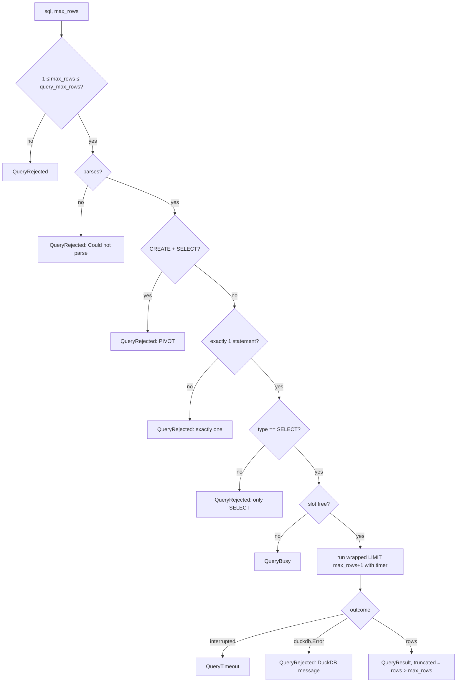

# Phase 1: Query guard — ✅ Done

**Goal**: A service function that safely runs one agent-written `SELECT` against the shared
read-only connection, with the connection locked so SQL cannot reach files, the network, or
the configuration.

Branch: `feat/query-guard`.

## Scope

- In scope: lockdown of `get_connection()`, new settings, `run_select` service, wire models,
  tests.
- Out of scope: any MCP code or dependency (Phase 2), any HTTP endpoint for SQL (none is
  planned), changes to existing services or routers.

## Implementation

### 1. `backend/app/core/config.py`

Add to `Settings`, after `sentry_dsn` and before the ingestion block, with one comment line
above them: `# Limits for agent-written SQL (app.services.sql) and MCP responses.`

```python
duckdb_memory_limit: str = "1GB"
query_default_rows: int = 200
query_max_rows: int = 2000
query_timeout_seconds: float = 10.0
query_concurrency: int = 2
mcp_max_response_bytes: int = 262144
```

### 2. `backend/app/core/duckdb.py`

Replace the body of `get_connection()` after the existence check with:

```python
settings = get_settings()
# The function filesystem is read-only except /tmp; DuckDB may spill there.
conn = duckdb.connect(
    str(path),
    read_only=True,
    config={
        "temp_directory": "/tmp/duckdb",
        "memory_limit": settings.duckdb_memory_limit,
    },
)
# Agent SQL (app.services.sql) runs on this connection, and DuckDB refuses a
# second connection to the same file with another config. The API itself never
# reads files or the network, so close both, then lock the settings so a query
# can't SET them back. Passing these in `config` instead rejects temp_directory.
conn.execute("SET enable_external_access = false")
conn.execute("SET lock_configuration = true")
return conn
```

Keep `path = get_settings().duckdb_path` (use the `settings` local for both). Update the module
docstring: add one sentence: "The connection is locked down (no file or network access, no
configuration changes) because `app.services.sql` runs agent-written SQL on it."

### 3. `backend/app/schemas/sql.py` (new)

```python
"""Wire models for agent-written SQL results."""

from typing import Any

from pydantic import BaseModel


class ColumnInfo(BaseModel):
    name: str
    type: str


class QueryResult(BaseModel):
    columns: list[ColumnInfo]
    rows: list[list[Any]]
    row_count: int
    truncated: bool
    elapsed_ms: int
```

### 4. `backend/app/services/sql.py` (new)

Public surface:

```python
class QueryRejected(ValueError):
    """The SQL is not exactly one SELECT statement, or failed to parse or run."""

class QueryTimeout(QueryRejected):
    """The query ran longer than ``query_timeout_seconds`` and was interrupted."""

class QueryBusy(QueryRejected):
    """All query slots are in use."""

def run_select(
    cur: duckdb.DuckDBPyConnection, sql: str, max_rows: int | None = None
) -> QueryResult: ...
```

`run_select` steps, in this order (the flowchart below is the same logic):

1. `max_rows = settings.query_default_rows if max_rows is None else max_rows`. If
   `max_rows < 1` or `max_rows > settings.query_max_rows` → `QueryRejected(f"max_rows must be
   between 1 and {query_max_rows}")`.
2. `statements = duckdb.extract_statements(sql)`. Catch `duckdb.Error` →
   `QueryRejected(f"Could not parse SQL: {exc}")`.
3. `types = [s.type for s in statements]`. If `types == [CREATE, SELECT]` (what one `PIVOT`
   parses into) → `QueryRejected("PIVOT is not supported; use GROUP BY with FILTER or CASE.")`.
   Check this before step 4, which would otherwise report "got 2".
4. `len(statements) != 1` → `QueryRejected(f"Send exactly one SQL statement; got {n}.")`.
   (Empty input and comment-only input give 0.)
5. `statements[0].type != duckdb.StatementType.SELECT` →
   `QueryRejected(f"Only SELECT queries are allowed; got {statements[0].type.name}.")`.
6. Acquire a slot from `_slots()` (a `threading.BoundedSemaphore`) with
   `blocking=False`. `_slots()` builds it from `settings.query_concurrency` in a
   `@functools.cache` helper `_slots()` so tests can change the setting before first use.
   Not acquired → `QueryBusy("Another query is running; retry in a few seconds.")`.
7. Wrap: `wrapped = f"SELECT * FROM (\n{statements[0].query}\n) AS q LIMIT {max_rows + 1}"`.
   (`statements[0].query` has no trailing semicolon. The inner `ORDER BY` is kept; verified.)
8. Start `timer = threading.Timer(settings.query_timeout_seconds, cur.interrupt)`;
   `start = time.perf_counter()`; `cur.execute(wrapped)`; `raw = cur.fetchall()`.
   - `duckdb.InterruptException` → `QueryTimeout(f"Query exceeded
     {query_timeout_seconds:g}s and was stopped. Aggregate in SQL or filter by fiscal year.")`.
   - Any other `duckdb.Error` → `QueryRejected(str(exc))`. This includes the
     `PermissionException` raised by the lockdown; its message is shown as-is.
   - `finally`: `timer.cancel()`, release the slot.
9. `columns = [ColumnInfo(name=d[0], type=str(d[1])) for d in cur.description]`.
10. `truncated = len(raw) > max_rows`; `rows = [list(r) for r in raw[:max_rows]]`.
11. Return `QueryResult(columns, rows, row_count=len(rows), truncated,
    elapsed_ms=round((time.perf_counter() - start) * 1000))`.

The byte cap is **not** applied here; it belongs to the transport (Phase 2), because it is about
what one MCP message can carry.

Docstring of `run_select` (Google style) states: one `SELECT`; the lockdown lives on the
connection (`app.core.duckdb`); `Raises:` the three exception classes.



### 5. `backend/tests/test_sql_guard.py` (new)

Use the existing `client` fixture for its side effect of pointing `get_connection()` at the
seeded DB (`seeded_db` + monkeypatch), then take `cur = get_connection().cursor()`. Define a
local fixture `cur(client)` that yields it and closes it.

Tests (one function each):

| Test | Input | Expect |
|---|---|---|
| `test_select_returns_columns_and_rows` | `SELECT record_date, transaction_type FROM deposits_withdrawals ORDER BY record_date LIMIT 3` | 3 rows, columns `record_date`/`DATE`, `transaction_type`/`VARCHAR`, `truncated is False` |
| `test_row_cap_sets_truncated` | `SELECT * FROM range(10)`, `max_rows=4` | 4 rows, `truncated is True` |
| `test_exact_cap_not_truncated` | `SELECT * FROM range(4)`, `max_rows=4` | `truncated is False` |
| `test_default_rows_from_settings` | `SELECT * FROM range(500)` | 200 rows, truncated |
| `test_max_rows_bounds` (parametrize `0`, `2001`) | | `QueryRejected` |
| `test_rejects_multiple_statements` | `SELECT 1; SELECT 2` | `QueryRejected`, "exactly one" |
| `test_rejects_empty` (parametrize `""`, `"-- note"`) | | `QueryRejected` |
| `test_rejects_non_select` (parametrize `INSERT INTO metadata VALUES ('a','b',now())`, `SET threads = 1`, `CREATE TABLE x (i INT)`, `EXPLAIN SELECT 1`, `CALL pragma_version()`, `ATTACH 'x.db'`, `COPY metadata TO 'x.csv'`) | | `QueryRejected`, "Only SELECT" |
| `test_rejects_pivot` | `PIVOT deposits_withdrawals ON transaction_type USING count(*)` | `QueryRejected`, message contains "GROUP BY" |
| `test_allows_select_shapes` (parametrize `DESCRIBE deposits_withdrawals`, `SHOW TABLES`, `FROM metadata`, `VALUES (1)`) | | returns a `QueryResult` |
| `test_file_access_blocked` (parametrize `SELECT * FROM read_csv('/etc/passwd')`, `SELECT * FROM read_text('/proc/self/environ')`, `SELECT * FROM 'https://example.com/x.csv'`) | | `QueryRejected`; message contains "disabled" or "Permission" |
| `test_configuration_locked` | `SELECT current_setting('enable_external_access')` | value `False`; and a raw `cur.execute("SET enable_external_access = true")` raises `duckdb.InvalidInputException` |
| `test_parse_error` | `SELEC 1` | `QueryRejected`, "Could not parse" |
| `test_timeout_interrupts` | monkeypatch `get_settings().query_timeout_seconds = 0.2`; `SELECT count(*) FROM range(10000000000) a` | `QueryTimeout` raised in < 5 s |
| `test_busy_when_no_slot` | monkeypatch `app.services.sql._slots` to return `threading.BoundedSemaphore(1)` already acquired | `QueryBusy` |
| `test_api_still_works_after_lockdown` | `client.get("/api/v1/meta/stats")` | 200 (the lockdown does not break `.df()` services) |

## Verification

- [x] `cd backend && uv run pytest tests/test_sql_guard.py -x` — all pass.
- [x] `cd backend && uv run pytest` — the full suite passes (the lockdown breaks no existing endpoint).
- [x] `cd backend && uv run ruff check . && uv run ruff format --check .` — clean.
- [x] `git diff --exit-code docs/contracts/openapi.json` — no change.
- [x] Spill still works under lockdown, run once by hand against a real artifact
      (`uv run python -m scripts.fetch_artifact` first if `data/treasury_data.duckdb` is missing):
      `APP_DUCKDB_MEMORY_LIMIT=50MB uv run python -c "from app.core.duckdb import get_connection as g; from app.services.sql import run_select as r; print(r(g().cursor(), 'SELECT * FROM deposits_withdrawals ORDER BY transaction_catg_desc, record_date', 5).row_count)"`
      prints `5` and raises no `PermissionException`. If it raises "Out of Memory" instead, spilling
      is off: record that in Notes and keep `1GB` (the limit still protects the process).
- [x] `uv run fastapi dev` then open `http://localhost:8000/api/v1/meta/stats` — 200.

## Notes

- `memory_limit` and the lockdown apply to the API as well. That is intended: the API reads only
  its own file.
- `duckdb.InterruptException` is a subclass of `duckdb.Error`, so catch it **first**.
- Verified on landing: the spill check against the real artifact with
  `APP_DUCKDB_MEMORY_LIMIT=50MB` printed `5` with no `PermissionException`, so spilling to
  `/tmp/duckdb` works under the lockdown. 29 guard tests; full suite 138 passed.
